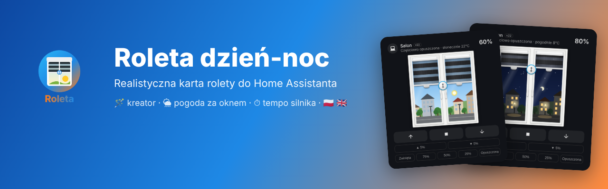
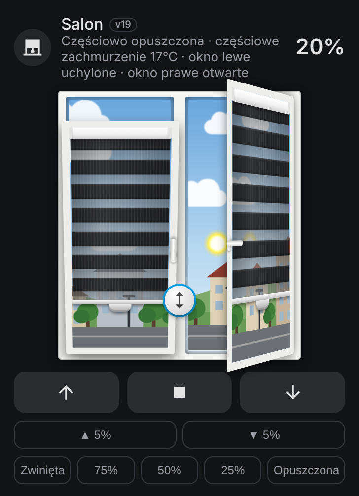
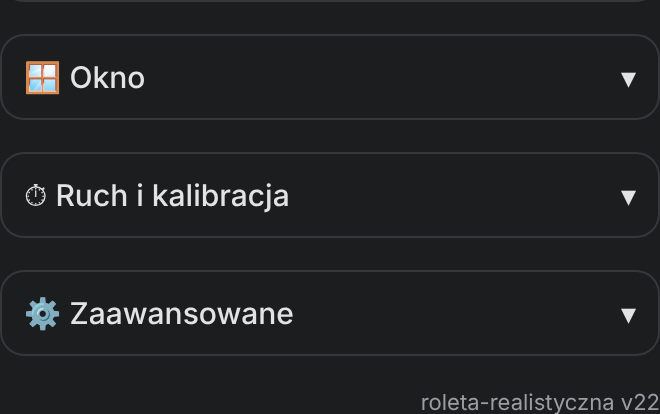
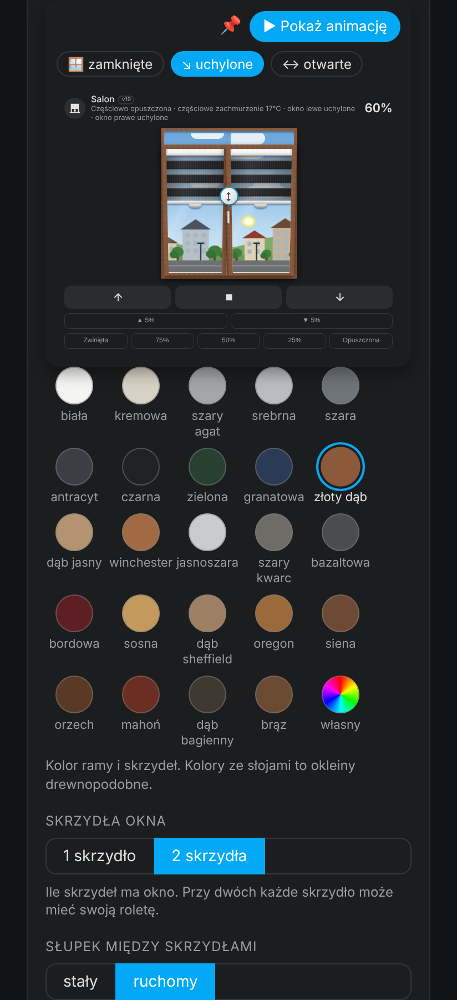
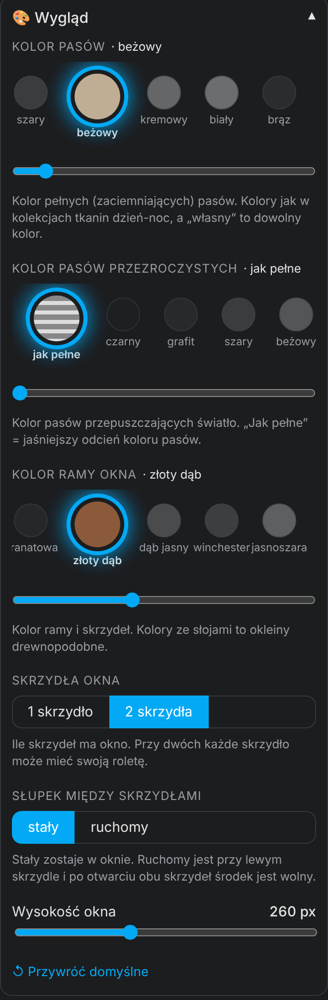
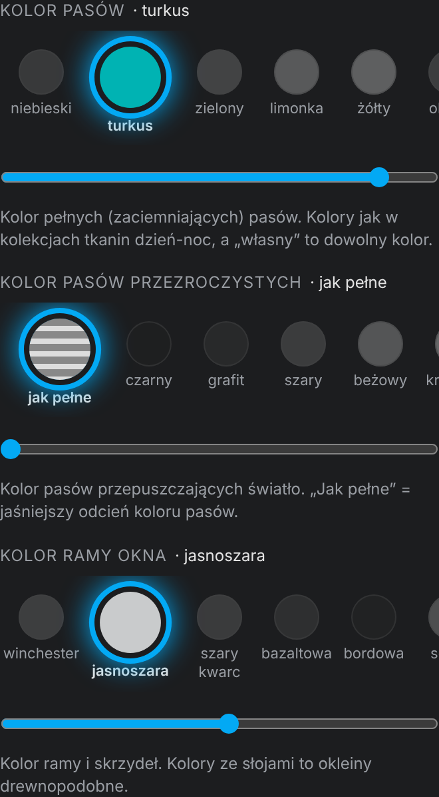
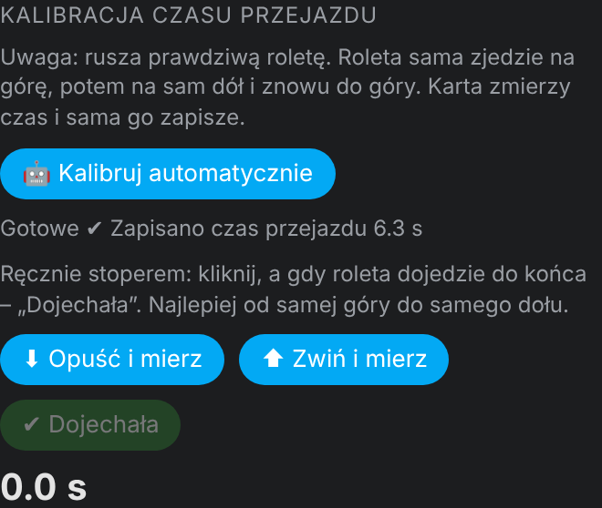
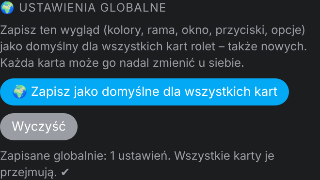

<p align="center">
  <a href="https://github.com/superdarco78/roleta-realistyczna/releases"></a>
  <a href="https://github.com/superdarco78/roleta-realistyczna/releases"></a>
  <a href="https://github.com/superdarco78/roleta-realistyczna/commits/main"></a>
  <a href="https://github.com/superdarco78/roleta-realistyczna/commits/main"></a>
  <br>
  <a href="https://hacs.xyz"></a>
  <a href="https://www.home-assistant.io/"></a>
  <a href="LICENSE"></a>
    <br>
  <a href="https://github.com/superdarco78/roleta-realistyczna/actions/workflows/release.yml"></a>
  <a href="https://github.com/superdarco78/roleta-realistyczna/stargazers"></a>
  <a href="https://github.com/superdarco78/roleta-realistyczna/issues"></a>
  
  
  <a href="https://github.com/superdarco78"></a>
  <br>
  <a href="https://github.com/superdarco78/roleta-realistyczna/actions/workflows/validate.yml"></a>
  <a href="https://github.com/superdarco78/roleta-realistyczna/releases/latest"></a>
  
  <!-- Wsparcie (odkomentuj po podaniu linków):
  <a href="https://www.buymeacoffee.com/LINK"></a>
  <a href="https://www.paypal.com/donate/?hosted_button_id=LINK"></a>
  -->
</p>
<p align="center">
  <a href="https://www.home-assistant.io/"></a>
  <a href="https://community.home-assistant.io/"></a>
  <a href="https://forum.arturhome.pl/"></a>
  <a href="https://hacs.xyz/"></a>
</p>

<p align="center"><a href="https://my.home-assistant.io/redirect/hacs_repository/?owner=superdarco78&repository=roleta-realistyczna&category=plugin"></a></p>


<p align="center"></p>

README: **🇵🇱 Polski** | [🇬🇧 English](README_EN.md)

> 💡 **Roleta dzień-noc** to karta do Home Assistanta, która pokazuje Twoją roletę dzień-noc (zebra) na prawdziwym oknie. Roletę przesuwasz palcem, animacja jedzie w tempie silnika, a za szybą widać aktualną pogodę i porę dnia. Przy dodaniu karty kreator ustawia wszystko sam, bez YAML.

<p align="center"></p>

## 📑 Spis treści

1. [✨ Co potrafi](#-co-potrafi)
2. [🖼 Galeria](#-galeria)
3. [📋 Wymagania](#-wymagania)
4. [⬇️ Instalacja przez HACS (zalecana)](#️-instalacja-przez-hacs-zalecana)
5. [🛠 Instalacja ręczna](#-instalacja-ręczna)
6. [🪄 Pierwsze uruchomienie: kreator](#-pierwsze-uruchomienie-kreator)
7. [👆 Jak sterować](#-jak-sterować)
8. [🎛 Edytor krok po kroku](#-edytor-krok-po-kroku)
   - [Podgląd na żywo](#podgląd-na-żywo)
   - [🎨 Wygląd](#-wygląd)
   - [🪟 Okno i kontaktrony](#-okno-i-kontaktrony)
   - [⏱ Ruch i kalibracja](#-ruch-i-kalibracja)
   - [⚙️ Zaawansowane i ustawienia globalne](#️-zaawansowane-i-ustawienia-globalne)
9. [📄 Wszystkie opcje (YAML)](#-wszystkie-opcje-yaml)
10. [🧪 Przykłady](#-przykłady)
11. [🔌 Silniki Moes / Tuya](#-silniki-moes--tuya)
12. [❓ Pytania i problemy](#-pytania-i-problemy)
13. [🔄 Aktualizacja](#-aktualizacja)
14. [📝 Historia zmian](CHANGELOG.md)

---

## ✨ Co potrafi

| | |
|---|---|
| 🪄 **Kreator** | Sam się otwiera przy nowej karcie: wybierasz roletę, karta pokazuje, co wykryła, wybierasz wygląd. |
| 🔍 **Sama wykrywa** | Grupę rolet (lewa + prawa), prędkość silnika z tego samego urządzenia, kontaktrony okna z tego samego pomieszczenia. Bez pomocników i bez YAML. |
| 🌍 **Twój język** | Polski albo angielski, automatycznie według języka w Home Assistancie. |
| 👆 **Sterowanie palcem** | Uchwyt na listwie rusza jedno skrzydło, okrągły uchwyt na środku oba. Dotknięcie w trakcie jazdy = STOP. |
| ⏱ **Animacja 1:1 z silnikiem** | Tempo z prędkości silnika, z kalibracji jednym przyciskiem albo karta uczy się sama. Fałszywe meldunki Zigbee (0% / 100%) nie psują animacji. |
| 🌦 **Pogoda za oknem** | Słońce, chmury, deszcz, ulewa, burza z błyskami, śnieg, mgła i wiatr. Bez integracji pogody karta pobiera ją z internetu (Open-Meteo, bez klucza). |
| 🌅 **Pora dnia** | Dzień, złota godzina, zmierzch i noc z księżycem, gwiazdami i zapalonymi oknami, według słońca w HA. |
| 🪟 **Okno jak prawdziwe** | Uchylone albo otwarte według kontaktronu, obracające się klamki, słupek stały lub ruchomy, 1 albo 2 skrzydła, własne zdjęcie widoku. |
| 🎨 **Kolory jak w sklepie** | Tkaniny dzień-noc, okleiny drewnopodobne (złoty dąb, orzech, winchester, mahoń…) i kolory gładkie. |
| 🌍 **Ustawienia globalne** | Jeden wygląd dla wszystkich kart jednym kliknięciem. |

## 🖼 Galeria

Zrzuty dopasowują się do motywu GitHuba (jasny / ciemny), tak jak karta dopasowuje się do motywu HA.

<table>
<tr>
<td align="center"><b>☀️ Słońce</b><br><picture><source media="(prefers-color-scheme: dark)" srcset="img/stany/dzien.png"></picture></td>
<td align="center"><b>🌧 Deszcz</b><br><picture><source media="(prefers-color-scheme: dark)" srcset="img/stany/deszcz.png"></picture></td>
<td align="center"><b>❄️ Śnieg</b><br><picture><source media="(prefers-color-scheme: dark)" srcset="img/stany/snieg.png"></picture></td>
</tr>
<tr>
<td align="center"><b>⛈ Burza</b><br><picture><source media="(prefers-color-scheme: dark)" srcset="img/stany/burza.png"></picture></td>
<td align="center"><b>🌫 Mgła</b><br><picture><source media="(prefers-color-scheme: dark)" srcset="img/stany/mgla.png"></picture></td>
<td align="center"><b>🌅 Zachód słońca</b><br><picture><source media="(prefers-color-scheme: dark)" srcset="img/stany/zachod.png"></picture></td>
</tr>
<tr>
<td align="center"><b>🌙 Noc</b><br><picture><source media="(prefers-color-scheme: dark)" srcset="img/stany/noc.png"></picture></td>
<td align="center"><b>🪟 Okno uchylone i otwarte</b><br><picture><source media="(prefers-color-scheme: dark)" srcset="img/stany/okno.png"></picture></td>
<td align="center"><b>🇬🇧 Język HA: English</b><br><picture><source media="(prefers-color-scheme: dark)" srcset="img/stany/en.png"></picture></td>
</tr>
</table>

<details>
<summary><b>🌅 Więcej: pory dnia, okleiny, klamki</b></summary>

<br>
 
</details>

## 📋 Wymagania

- Home Assistant **2024.8** lub nowszy.
- Roleta jako encja `cover.*` (dowolna integracja: Zigbee, Z-Wave, Tuya, Shelly, Somfy…). Może być też grupa dwóch rolet (lewe + prawe skrzydło).
- Opcjonalnie: encja pogody `weather.*`, kontaktrony okna `binary_sensor.*`, encja prędkości silnika `number.*_motor_speed`. Karta znajdzie je sama.
- [HACS](https://hacs.xyz) do instalacji jednym kliknięciem (bez HACS też się da, patrz [instalacja ręczna](#-instalacja-ręczna)).

## ⬇️ Instalacja przez HACS (zalecana)

Dzięki HACS każdą nową wersję zainstalujesz jednym kliknięciem „Aktualizuj”.

**Krok 1.** Kliknij przycisk:

[](https://my.home-assistant.io/redirect/hacs_repository/?owner=superdarco78&repository=roleta-realistyczna&category=plugin)

**Krok 2.** Kliknij **Otwórz link**. Za pierwszym razem strona zapyta o adres Twojego HA. Gdy HACS zapyta „Dodać repozytorium?”, kliknij **Dodaj**.


**Krok 3.** Kliknij **Pobierz** na dole po prawej, potem jeszcze raz **Pobierz** w okienku.


**Krok 4.** Odśwież stronę: **Ctrl + Shift + R** (w telefonie zamknij i otwórz aplikację HA). Przejdź do [pierwszego uruchomienia](#-pierwsze-uruchomienie-kreator).

<details>
<summary>Przycisk nie działa? Dodaj repozytorium ręcznie w HACS</summary>

1. **HACS → ⋮ (prawy górny róg) → Własne repozytoria**.
2. Repozytorium: `https://github.com/superdarco78/roleta-realistyczna`, typ: **Dashboard**, **Dodaj**.
3. Wyszukaj „Roleta dzień-noc” → **Pobierz**.
</details>

## 🛠 Instalacja ręczna

Bez HACS. Potrzebny dodatek **File editor** (Ustawienia → Dodatki → Sklep z dodatkami → File editor → Zainstaluj).

| Krok | Co zrobić | Zrzut |
|:---:|---|---|
| 1 | Pobierz `roleta-realistyczna.js` z [najnowszego wydania](https://github.com/superdarco78/roleta-realistyczna/releases/latest). |  |
| 2 | W **File editor** otwórz folder `www` i wgraj plik strzałką w górę. |  |
| 3 | **Ustawienia → Pulpity**. |  |
| 4 | **⋮ → Zasoby**. Brak „Zasoby”? Włącz *Tryb zaawansowany* w swoim profilu. |  |
| 5 | **Dodaj zasób**: `/local/roleta-realistyczna.js`, **Moduł JavaScript**, **Utwórz**. Potem **Ctrl + Shift + R**. |  |

## 🪄 Pierwsze uruchomienie: kreator

**Krok 1.** Na pulpicie kliknij ołówek (Edytuj) → **＋ Dodaj kartę** → wpisz **Roleta** → kliknij kartę.


**Krok 2.** Kreator otworzy się sam i przeprowadzi Cię przez 3 kroki:

| 1️⃣ Wybierz roletę | 2️⃣ Co karta wykryła | 3️⃣ Gotowy wygląd |
|:---:|:---:|:---:|
|  |  |  |
| Grupy rolet są na górze listy. | Silnik, kontaktrony, pogoda. Niczego nie musisz dodawać. | 6 gotowych stylów: nowoczesny, drewno, skandynawski, ciemny, orzech, kolorowy. |

✅ **Gotowe.** Wszystko inne zmienisz w edytorze karty.

## 👆 Jak sterować

| Gest | Co się stanie |
|---|---|
| Przeciągnij uchwyt na **listwie skrzydła** | Rusza tylko to skrzydło. |
| Przeciągnij **okrągły uchwyt ⇕** na środku | Rusza oba skrzydła naraz. |
| Przeciągnij w dowolnym miejscu szyby | Rusza oba skrzydła (albo jedno z opcją *osobno*). |
| **Dotknij roletę** w trakcie jazdy | STOP. Kolejne dotknięcie = jazda w drugą stronę. |
| Przyciski **↑ ■ ↓** | Zwiń, zatrzymaj, opuść. |
| Przyciski **▲ 5% / ▼ 5%** | Mały krok; kliknięcia się sumują. |
| Szybkie pozycje | Zwinięta / 75% / 50% / 25% / Opuszczona (własne do ustawienia). |

Po puszczeniu palca przerywana linia **„→ 50%”** pokazuje, dokąd roleta jedzie, a w nagłówku widać np. „30% → 50%”.

 

## 🎛 Edytor krok po kroku

Edytor otworzysz tak: pulpit → ołówek → kliknij kartę rolety. Ustawienia są w rozwijanych działach. W każdym jest **↺ Przywróć domyślne**.



### Podgląd na żywo

Na górze edytora jest podgląd, który **nie rusza prawdziwej rolety**. Przyciskiem **▶ Pokaż animację** zobaczysz ruch w tempie Twojego silnika, a przyciskami pogody sprawdzisz deszcz, burzę, śnieg albo noc. Pinezka 📌 przypina podgląd u góry, żeby widzieć każdą zmianę od razu.

 

### 🎨 Wygląd

| Ustawienie | Opis |
|---|---|
| **Kolor pasów** | Kolor pełnych (zaciemniających) pasów. Palety jak w kolekcjach tkanin dzień-noc albo własny kolor. |
| **Kolor pasów przezroczystych** | „Jak pełne” = jaśniejszy odcień, albo dowolny inny. |
| **Kolor ramy okna** | Okleiny drewnopodobne ze słojami i kolory gładkie. |
| **Skrzydła okna** | 1 albo 2. Przy dwóch każde skrzydło może mieć swoją roletę. |
| **Słupek** | Stały albo ruchomy (przy lewym skrzydle, po otwarciu obu środek jest wolny). |
| **Wysokość okna** | W pikselach. |

Kolor wybierasz kółkiem albo przesuwając palcem suwak pod paletą.

 

### 🪟 Okno i kontaktrony

Wybierz kontaktron lewego i prawego skrzydła (albo zostaw auto-wykrywanie) i powiedz karcie, czy skrzydło po otwarciu jest **uchylone** czy **otwarte**. Suwaki ustalają, jak mocno.


### ⏱ Ruch i kalibracja

Czas przejazdu karta ustala sama z prędkości silnika albo uczy się go z każdego ruchu. Jeśli animacja nie zgadza się z roletą, kliknij **🤖 Kalibruj automatycznie**: roleta sama pojedzie na górę, na dół i znowu do góry, a karta zapisze czas. Można też zmierzyć ręcznie stoperem.



### ⚙️ Zaawansowane i ustawienia globalne

Język karty, przyciski, uchwyty, ruch krokowy, szybkie pozycje, wibracja, odwrócona pozycja, źródło pogody i własne zdjęcie zza okna. **🌍 Zapisz jako domyślne** przenosi Twój wygląd na wszystkie karty rolet, także nowe.



## 📄 Wszystkie opcje (YAML)

Wszystko ustawisz w edytorze. YAML jest dla chętnych.

| Opcja | Domyślnie | Opis |
|---|---|---|
| `entity` | – | **Wymagane.** Roleta `cover.*` albo grupa rolet (lewa + prawa). |
| `name` | nazwa encji | Nazwa na karcie. |
| `roleta_lewa` / `roleta_prawa` | – | Osobne rolety skrzydeł (zamiast grupy). |
| `kolor` | `czarny` | Kolor pełnych pasów (nazwa z palety albo `#rrggbb`). |
| `siatka` | jak pełne | Kolor pasów przezroczystych. |
| `rama` | `#f4f4f2` | Kolor ramy (nazwa okleiny albo `#rrggbb`). |
| `skrzydla` | `2` | Liczba skrzydeł: `1` albo `2`. |
| `slupek` | `staly` | `staly` albo `ruchomy`. |
| `klamki` | `true` | Klamki obracają się przy uchyleniu i otwarciu. |
| `wysokosc` | `260` | Wysokość okna w px. |
| `czas` | `auto` | Czas pełnego przejazdu w sekundach albo `auto`. |
| `predkosc_lewa` / `predkosc_prawa` | auto | Encje prędkości silników (`number.*`, obr/min). |
| `zrodlo` | `auto` | Pogoda: `auto` (encja HA, a gdy brak – internet), `internet`, `brak`. |
| `pogoda` | `auto` | Encja `weather.*`. |
| `niebo` | `true` | Niebo i pogoda za oknem. |
| `widok` | `true` | Rysowany widok: domy, drzewa, ulica. |
| `tlo` | – | Własne zdjęcie zza okna, np. `/local/okno.jpg`. |
| `czujnik_lewe` / `czujnik_prawe` | auto | Kontaktrony skrzydeł (`binary_sensor.*`). |
| `tryb_lewe` / `tryb_prawe` | `uchyl` | Po otwarciu skrzydło jest `uchyl` (uchylone) albo `otworz` (otwarte). |
| `kat_uchyl` | `14` | Jak mocno uchylone (stopnie). |
| `otwarcie` | `40` | Jak szeroko otwarte (% szerokości). |
| `auto_czujniki` | `true` | Sama szukaj kontaktronów w pomieszczeniu rolety. |
| `przyciski` | `true` | Przyciski i szybkie pozycje. |
| `pozycje` | `100,75,50,25,0` | Szybkie pozycje (100 = zwinięta). |
| `krok` | `5` | Krok przycisków ▲/▼ w %, `0` = wyłączony. |
| `uchwyty` | `true` | Uchwyty na listwach. |
| `uchwyt_srodek` | `true` | Środkowy uchwyt ⇕. |
| `osobno` | `false` | Przeciąganie po szybie rusza tylko jedno skrzydło. |
| `odwroc` | `false` | Odwrócona pozycja (gdy silnik liczy odwrotnie). |
| `wibracja` | `true` | Lekka wibracja telefonu przy kliknięciu. |
| `jezyk` | `auto` | `auto`, `pl` albo `en`. |

## 🧪 Przykłady

**Najprościej** (resztę karta wykryje sama):

```yaml
type: custom:roleta-realistyczna
entity: cover.zaluzje_salon
```

**Okno 2-skrzydłowe z osobnymi roletami i kontaktronami:**

```yaml
type: custom:roleta-realistyczna
entity: cover.salon_lewa
name: Salon
roleta_lewa: cover.salon_lewa
roleta_prawa: cover.salon_prawa
czujnik_lewe: binary_sensor.okno_salon_lewe
tryb_lewe: uchyl
czujnik_prawe: binary_sensor.okno_salon_prawe
tryb_prawe: otworz
```

**Drewniane okno z beżową tkaniną:**

```yaml
type: custom:roleta-realistyczna
entity: cover.zaluzje_kuchnia
name: Kuchnia
kolor: bezowy
rama: zloty_dab
wysokosc: 300
```

**Jedno skrzydło, bez pogody, po angielsku:**

```yaml
type: custom:roleta-realistyczna
entity: cover.bedroom
skrzydla: 1
zrodlo: brak
jezyk: en
```

## 🔌 Silniki Moes / Tuya

Karta była testowana na silnikach **Moes TS0601** (zigbee2mqtt).

- Jeśli silnik ma encję `number.<nazwa>_motor_speed`, czas animacji liczy się sam: czas ≈ 20,2 + 394 / obroty.
- Silnik nie melduje „otwiera się / zamyka się”. Karta rozpoznaje start ruchu po zmianie stanu.
- Fałszywe meldunki 0% / 100% w trakcie jazdy (nawet do 60 s po zatrzymaniu) są pomijane.
- Gdy silnik pokazuje złą pozycję końcową, ustaw ponownie krańcówki w zigbee2mqtt.

## ❓ Pytania i problemy

<details><summary><b>Nie ma karty na liście „Dodaj kartę”</b></summary>

Odśwież stronę **Ctrl + Shift + R**. W telefonie zamknij i otwórz aplikację HA. Przy instalacji ręcznej sprawdź, czy zasób to `/local/roleta-realistyczna.js` i typ **Moduł JavaScript**.
</details>

<details><summary><b>Animacja jest szybsza albo wolniejsza niż roleta</b></summary>

Edytor → ⏱ Ruch i kalibracja → **🤖 Kalibruj automatycznie**. Albo poczekaj: karta uczy się czasu z każdego ruchu.
</details>

<details><summary><b>Roleta skacze do 0% albo 100% w trakcie jazdy</b></summary>

To fałszywe meldunki silnika. Karta je pomija od v10. Jeśli dalej skacze, zgłoś błąd z nazwą silnika.
</details>

<details><summary><b>Nie widać pogody</b></summary>

Edytor → ⚙️ Zaawansowane → **Skąd brać pogodę**: `auto` albo `internet`. Karta pobiera pogodę z Open-Meteo dla lokalizacji domu z HA.
</details>

<details><summary><b>Roleta jedzie odwrotnie (góra = dół)</b></summary>

Włącz **Odwróć pozycję** w ⚙️ Zaawansowanych.
</details>

<details><summary><b>Karta jest po angielsku, a chcę po polsku</b></summary>

Karta bierze język z profilu HA. Możesz też ustawić **Język karty** w ⚙️ Zaawansowanych.
</details>

Nie ma tu odpowiedzi? [Zgłoś błąd](https://github.com/superdarco78/roleta-realistyczna/issues/new/choose) albo napisz na [forum HA](https://community.home-assistant.io/) / [forum arturhome.pl](https://forum.arturhome.pl/).

## 🔄 Aktualizacja

Przez HACS: gdy pojawi się nowa wersja, w **Ustawieniach** zobaczysz aktualizację „Roleta dzień-noc”. Kliknij **Aktualizuj** i odśwież stronę. Co się zmieniło: [📝 Historia zmian](CHANGELOG.md) albo [Wydania](https://github.com/superdarco78/roleta-realistyczna/releases).

---

## 📜 Licencja

[CC BY-NC-SA 4.0](LICENSE) © [superdarco78](https://github.com/superdarco78). Do własnego, niekomercyjnego użytku z podaniem autora.

<p align="center">Jeśli karta Ci się podoba, zostaw ⭐ na górze strony. Dziękuję!</p>
