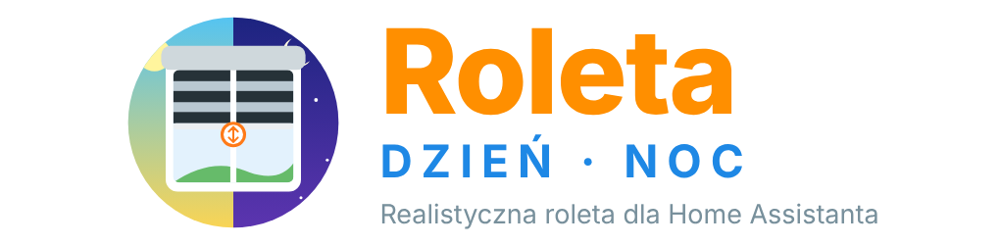
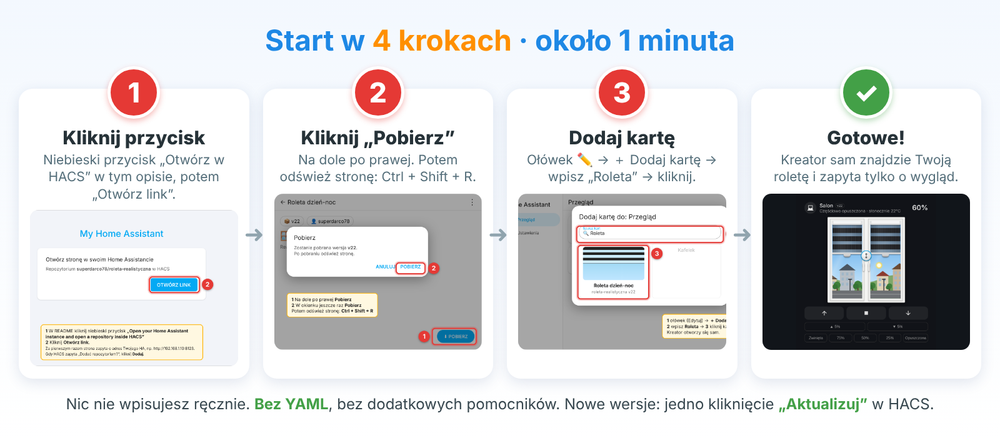
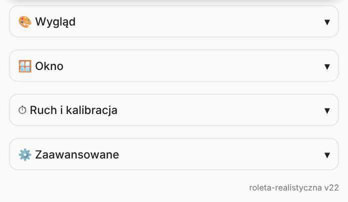
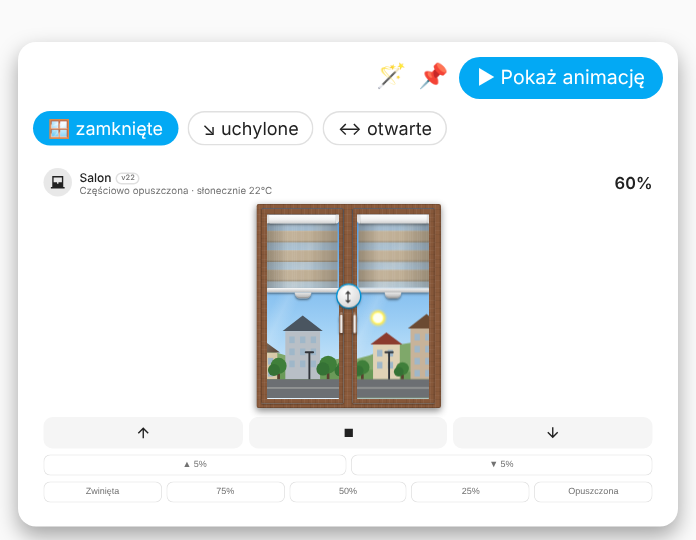
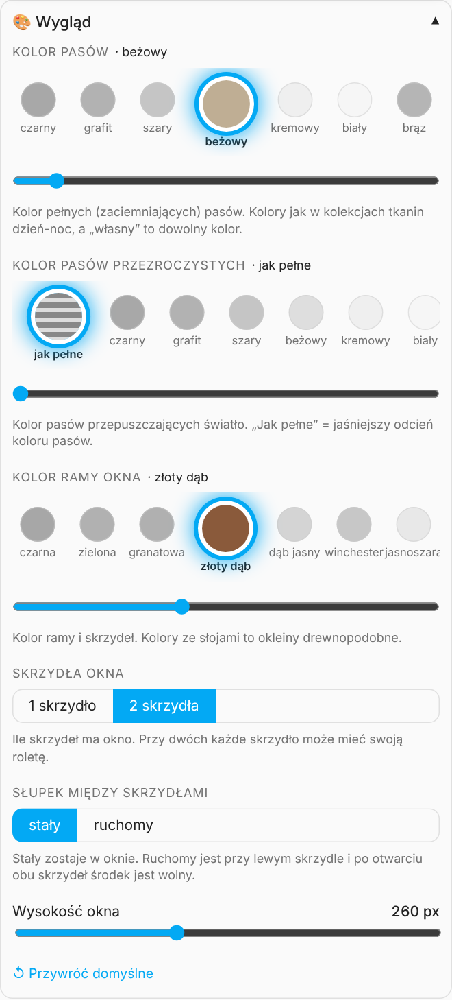
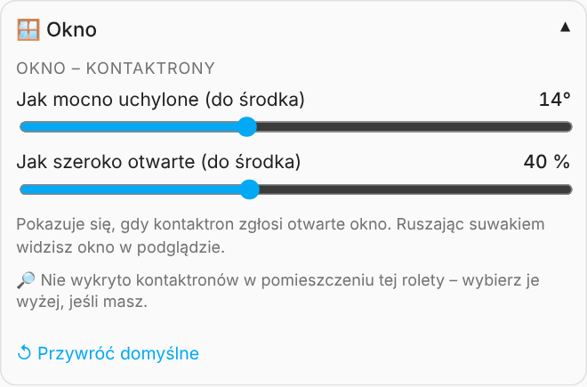
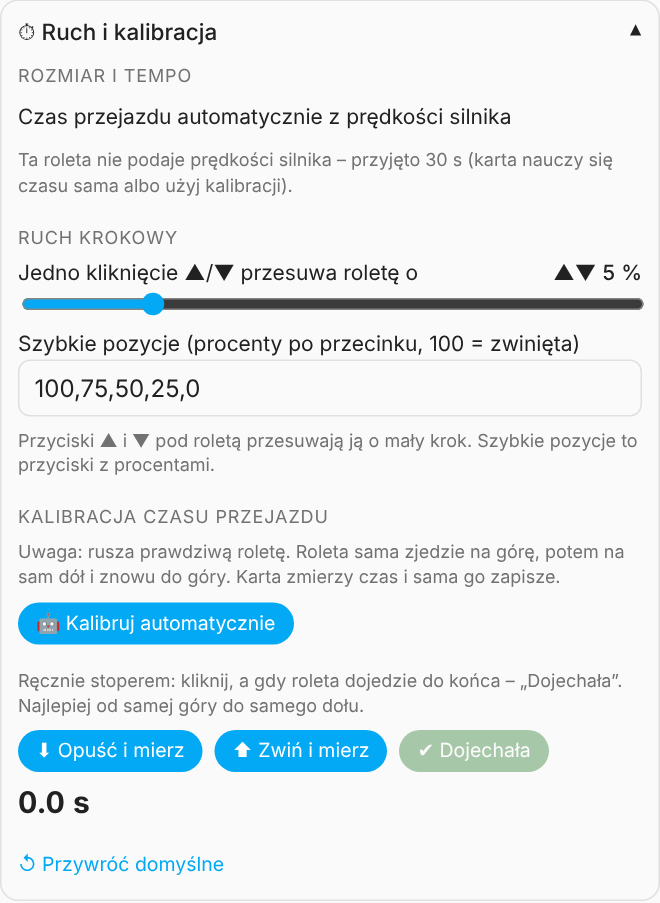
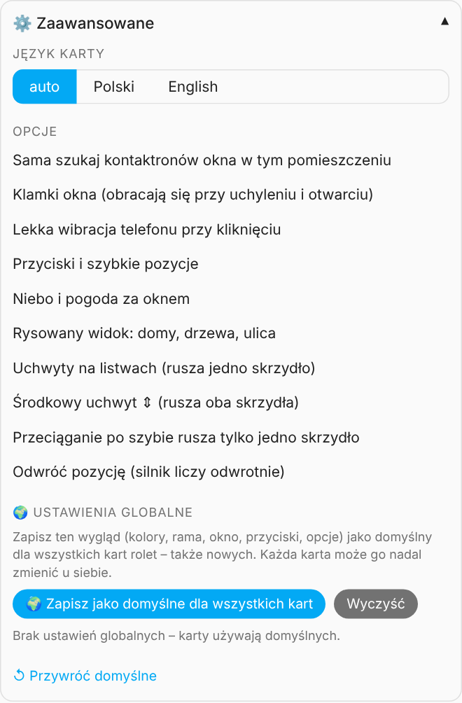

<p align="center"></p>

<p align="center">
  <a href="https://github.com/superdarco78/roleta-realistyczna/releases"></a>
  <a href="https://github.com/superdarco78/roleta-realistyczna/releases"></a>
  <a href="https://github.com/superdarco78/roleta-realistyczna/stargazers"></a>
  <a href="https://github.com/superdarco78/roleta-realistyczna/commits/main"></a>
  <br>
  <a href="https://hacs.xyz"></a>
  <a href="https://www.home-assistant.io/"></a>
  <a href="#tlumaczenia"></a>
  <a href="LICENSE"></a>
  <br>
  <a href="https://github.com/superdarco78/roleta-realistyczna/actions/workflows/validate.yml"></a>
  <a href="https://github.com/superdarco78/roleta-realistyczna/actions/workflows/release.yml"></a>
  <a href="https://github.com/superdarco78/roleta-realistyczna/issues"></a>
  <a href="https://github.com/superdarco78"></a>
  <br>
  <a href="https://community.home-assistant.io/"></a>
  <a href="https://forum.arturhome.pl/"></a>
  <!-- Wsparcie (odkomentuj po podaniu linku): <a href="https://www.buymeacoffee.com/LINK"></a> -->
</p>

<p align="center"><a href="https://my.home-assistant.io/redirect/hacs_repository/?owner=superdarco78&repository=roleta-realistyczna&category=plugin"></a></p>
README: **🇵🇱 Polski** | [🇬🇧 English](README_EN.md)

> [!TIP]
> Karta działa z **każdą roletą** w Home Assistancie (`cover.*`): Zigbee, Z-Wave, Tuya, Shelly, Somfy i innymi. Najlepiej wygląda z roletą dzień-noc (zebra) i oknem 2-skrzydłowym, ale ustawisz też 1 skrzydło. Po dodaniu karty **kreator ustawi wszystko sam**.

<p align="center"><picture><source media="(prefers-color-scheme: dark)" srcset="img/animacja-ciemna.gif"></picture></p>

<a name="start-w-4-krokach"></a>
## 🚀 Start w 4 krokach

<p align="center"><a href="#instalacja"></a></p>

<p align="center"><a href="https://my.home-assistant.io/redirect/hacs_repository/?owner=superdarco78&repository=roleta-realistyczna&category=plugin"></a><br><sub>⬆️ To jest przycisk z kroku 1</sub></p>

<details><summary><b>📖 Słowniczek: co znaczą te słowa?</b></summary>

| Słowo | Po ludzku |
|---|---|
| **Home Assistant (HA)** | Program, który steruje Twoim domem. |
| **HACS** | „Sklep” z dodatkami do HA. Stąd instalujesz kartę i jej aktualizacje. |
| **Karta** | Okienko na ekranie HA, np. ta roleta. |
| **Pulpit** | Ekran w HA, na którym leżą karty. |
| **Encja `cover.…`** | Twoja roleta, tak jak widzi ją HA. |
| **Kontaktron** | Czujnik na oknie: wie, czy okno jest zamknięte, uchylone czy otwarte. |
| **Zwinięta / 100%** | Roleta na samej górze, okno odsłonięte. |
| **Opuszczona / 0%** | Roleta na samym dole, okno zasłonięte. |
| **YAML** | Ręczne pisanie ustawień. **Tu niepotrzebne.** |
</details>

<a name="spis-tresci"></a>
## 📑 Spis treści

- [🚀 Start w 4 krokach](#start-w-4-krokach)
- [⬆️ Aktualizacja do v22 z wcześniejszych wersji](#aktualizacja-do-v22-z-wczesniejszych-wersji)
- [🪟 Karta Roleta dzień-noc](#karta-roleta-dzien-noc)
  - [Cele](#cele)
  - [Wygląd w różnych sytuacjach](#wyglad-w-roznych-sytuacjach)
  - [Kolory i okleiny](#kolory-i-okleiny)
- [⬇️ Instalacja](#instalacja)
  - [Przez HACS (zalecana)](#przez-hacs-zalecana)
  - [Ręcznie](#recznie)
- [🪄 Pierwsze uruchomienie: kreator](#pierwsze-uruchomienie-kreator)
- [👆 Akcje: jak sterować](#akcje-jak-sterowac)
- [🎛 Edytor](#edytor)
  - [Podgląd na żywo](#podglad-na-zywo)
  - [🎨 Wygląd](#wyglad)
  - [🪟 Okno i kontaktrony](#okno-i-kontaktrony)
  - [⏱ Ruch i kalibracja](#ruch-i-kalibracja)
  - [⚙️ Zaawansowane](#zaawansowane)
  - [🌍 Ustawienia globalne](#ustawienia-globalne)
- [📄 Opcje](#opcje)
  - [Podstawowe](#podstawowe)
  - [Wygląd](#wyglad-1)
  - [Okno i kontaktrony](#okno-i-kontaktrony-1)
  - [Ruch](#ruch)
  - [Pogoda i widok](#pogoda-i-widok)
  - [Przyciski i sterowanie](#przyciski-i-sterowanie)
- [🧪 Przykłady](#przyklady)
- [🔎 Automatyczne wykrywanie](#automatyczne-wykrywanie)
- [🔌 Silniki Moes / Tuya](#silniki-moes-tuya)
- [🧩 Elementy karty](#elementy-karty)
- [❓ Pytania i problemy](#pytania-i-problemy)
- [🙋 Pomoc mile widziana](#pomoc-mile-widziana)
- [🌍 Tłumaczenia](#tlumaczenia)
- [🧱 Budowa projektu](#budowa-projektu)
- [☕ Wsparcie](#wsparcie)

---

<a name="aktualizacja-do-v22-z-wczesniejszych-wersji"></a>
## ⬆️ Aktualizacja do v22 z wcześniejszych wersji

> [!IMPORTANT]
> Wersja 22 **nie zmienia** istniejących ustawień. Twoje karty działają dalej bez zmian.

**Co nowego:**

- 🪄 **Kreator w 3 krokach** otwiera się sam przy dodaniu nowej karty.
- Edytor jest podzielony na rozwijane działy: 🎨 Wygląd, 🪟 Okno, ⏱ Ruch i kalibracja, ⚙️ Zaawansowane. W każdym jest **↺ Przywróć domyślne**.

**Co warto zrobić:**

1. Zaktualizuj kartę w HACS i odśwież stronę (**Ctrl + Shift + R**).
2. Otwórz edytor karty i sprawdź, czy wszystko wygląda jak trzeba.
3. Jeśli masz kilka kart rolet, ustaw wygląd w jednej i kliknij **🌍 Zapisz jako domyślne dla wszystkich kart**.

Pełna lista zmian: [📝 Historia zmian](CHANGELOG.md).

---

<a name="karta-roleta-dzien-noc"></a>
## 🪟 Karta Roleta dzień-noc

Karta pokazuje Twoją roletę dzień-noc na prawdziwym oknie. Roletę przesuwasz palcem, animacja jest zsynchronizowana z silnikiem, a za szybą widać aktualną pogodę i porę dnia.

<p align="center"><picture><source media="(prefers-color-scheme: dark)" srcset="img/opis-elementow-ciemny.png"></picture></p>

<a name="cele"></a>
### Cele

- ✅ Roleta na ekranie ma wyglądać i ruszać się **jak prawdziwa**.
- ✅ Ustawienie ma zająć **minutę, bez YAML** i bez dodawania pomocników.
- ✅ Wygodne sterowanie **palcem na telefonie i tablecie**.
- ✅ Karta ma działać z **każdą** roletą i **każdym** domem (język, pogoda, czujniki).

<a name="wyglad-w-roznych-sytuacjach"></a>
### Wygląd w różnych sytuacjach

Zrzuty dopasowują się do motywu (jasny / ciemny), tak jak karta dopasowuje się do motywu Home Assistanta.

**Pogoda za oknem:**

<table>
<tr>
<td align="center"><b>☀️ Słońce</b><br><picture><source media="(prefers-color-scheme: dark)" srcset="img/stany/dzien.png"></picture></td>
<td align="center"><b>🌧 Deszcz</b><br><picture><source media="(prefers-color-scheme: dark)" srcset="img/stany/deszcz.png"></picture></td>
<td align="center"><b>⛈ Burza</b><br><picture><source media="(prefers-color-scheme: dark)" srcset="img/stany/burza.png"></picture></td>
</tr>
<tr>
<td align="center"><b>❄️ Śnieg</b><br><picture><source media="(prefers-color-scheme: dark)" srcset="img/stany/snieg.png"></picture></td>
<td align="center"><b>🌫 Mgła</b><br><picture><source media="(prefers-color-scheme: dark)" srcset="img/stany/mgla.png"></picture></td>
<td align="center"><b>☁️ Pochmurno (po angielsku)</b><br><picture><source media="(prefers-color-scheme: dark)" srcset="img/stany/en.png"></picture></td>
</tr>
</table>

**Pora dnia:**

<table>
<tr>
<td align="center"><b>☀️ Dzień</b><br><picture><source media="(prefers-color-scheme: dark)" srcset="img/stany/zwinieta.png"></picture></td>
<td align="center"><b>🌅 Zachód słońca</b><br><picture><source media="(prefers-color-scheme: dark)" srcset="img/stany/zachod.png"></picture></td>
<td align="center"><b>🌙 Noc</b><br><picture><source media="(prefers-color-scheme: dark)" srcset="img/stany/noc.png"></picture></td>
</tr>
</table>

<details><summary>🌅 Wszystkie pory dnia na jednym obrazku</summary></details>

**Pozycja rolety:**

<table>
<tr>
<td align="center"><b>⬆️ Zwinięta (100%)</b><br><picture><source media="(prefers-color-scheme: dark)" srcset="img/stany/zwinieta.png"></picture></td>
<td align="center"><b>↕️ W połowie (50%)</b><br><picture><source media="(prefers-color-scheme: dark)" srcset="img/stany/zachod.png"></picture></td>
<td align="center"><b>⬇️ Opuszczona (0%)</b><br><picture><source media="(prefers-color-scheme: dark)" srcset="img/stany/opuszczona.png"></picture></td>
</tr>
</table>

**Okno (według kontaktronów):**

<table>
<tr>
<td align="center"><b>↘ Lewe uchylone</b><br><picture><source media="(prefers-color-scheme: dark)" srcset="img/stany/uchylone.png"></picture></td>
<td align="center"><b>↔ Prawe otwarte</b><br><picture><source media="(prefers-color-scheme: dark)" srcset="img/stany/otwarte.png"></picture></td>
<td align="center"><b>🪟 Uchylone i otwarte</b><br><picture><source media="(prefers-color-scheme: dark)" srcset="img/stany/okno.png"></picture></td>
</tr>
</table>

<a name="kolory-i-okleiny"></a>
### Kolory i okleiny

<table>
<tr>
<td align="center"><b>Złoty dąb + beż</b><br><picture><source media="(prefers-color-scheme: dark)" srcset="img/stany/zloty.png"></picture></td>
<td align="center"><b>Antracyt + turkus</b><br><picture><source media="(prefers-color-scheme: dark)" srcset="img/stany/turkus.png"></picture></td>
<td align="center"><b>1 skrzydło</b><br><picture><source media="(prefers-color-scheme: dark)" srcset="img/stany/jedno.png"></picture></td>
</tr>
</table>

<details><summary>🎨 Więcej: okleiny ze słojami i klamki</summary></details>

---

<a name="instalacja"></a>
## ⬇️ Instalacja

**Wymagania:** Home Assistant **2024.8** lub nowszy i roleta jako encja `cover.*`.

<a name="przez-hacs-zalecana"></a>
### Przez HACS (zalecana)

Dzięki HACS każdą nową wersję zainstalujesz jednym kliknięciem „Aktualizuj”.

**Krok 1.** Kliknij przycisk:

[](https://my.home-assistant.io/redirect/hacs_repository/?owner=superdarco78&repository=roleta-realistyczna&category=plugin)

**Krok 2.** Kliknij **Otwórz link**. Za pierwszym razem strona zapyta o adres Twojego HA. Gdy HACS zapyta „Dodać repozytorium?”, kliknij **Dodaj**.


**Krok 3.** Kliknij **Pobierz** na dole po prawej, potem jeszcze raz **Pobierz** w okienku.


**Krok 4.** Odśwież stronę: **Ctrl + Shift + R** (w telefonie zamknij i otwórz aplikację HA).

<details>
<summary>Przycisk nie działa? Dodaj repozytorium ręcznie w HACS</summary>

1. **HACS → ⋮ (prawy górny róg) → Własne repozytoria**.
2. Repozytorium: `https://github.com/superdarco78/roleta-realistyczna`, typ: **Dashboard**, **Dodaj**.
3. Wyszukaj „Roleta dzień-noc” → **Pobierz**.
</details>

<a name="recznie"></a>
### Ręcznie

Bez HACS. Potrzebny dodatek **File editor** (Ustawienia → Dodatki → Sklep z dodatkami → File editor → Zainstaluj).

**Krok 1. Pobierz plik karty**

Wejdź w [najnowsze wydanie](https://github.com/superdarco78/roleta-realistyczna/releases/latest) i kliknij `roleta-realistyczna.js`. Plik zapisze się w folderze Pobrane.


**Krok 2. Wgraj plik do Home Assistanta**

Otwórz **File editor**. Kliknij ikonę folderu, wejdź do folderu `www` i wgraj plik strzałką w górę.


**Krok 3. Otwórz Pulpity**

Kliknij **Ustawienia** na dole menu po lewej, potem **Pulpity**.


**Krok 4. Otwórz Zasoby**

Kliknij trzy kropki **⋮** w prawym górnym rogu, potem **Zasoby**.


**Krok 4a. Nie widzisz „Zasoby”? Włącz tryb zaawansowany**

Kliknij swoje imię na dole menu po lewej i włącz **Tryb zaawansowany**. Potem wróć do kroku 4.


**Krok 5. Dodaj kartę jako zasób**

Kliknij **Dodaj zasób**, wpisz `/local/roleta-realistyczna.js`, wybierz **Moduł JavaScript** i kliknij **Utwórz**. Na koniec odśwież stronę: **Ctrl + Shift + R**.


---

<a name="pierwsze-uruchomienie-kreator"></a>
## 🪄 Pierwsze uruchomienie: kreator

**Krok 1.** Na pulpicie kliknij ołówek (Edytuj) → **＋ Dodaj kartę** → wpisz **Roleta** → kliknij kartę.


**Krok 2.** Kreator otworzy się sam i przeprowadzi Cię przez 3 kroki:

**1️⃣ Wybierz roletę**

Grupy rolet (okno 2-skrzydłowe) są na górze listy.


**2️⃣ Zobacz, co karta wykryła**

Silnik, kontaktrony i pogoda. Niczego nie musisz dodawać.


**3️⃣ Wybierz wygląd**

6 gotowych stylów: nowoczesny, drewno, skandynawski, ciemny, orzech, kolorowy.


✅ **Gotowe.** Wszystko inne zmienisz w [edytorze](#edytor).

---

<a name="akcje-jak-sterowac"></a>
## 👆 Akcje: jak sterować

| Akcja | Jak | Co się stanie |
|---|---|---|
| **Przesuń jedno skrzydło** | Przeciągnij uchwyt  na listwie skrzydła | Rusza tylko to skrzydło. |
| **Przesuń oba skrzydła** | Przeciągnij okrągły uchwyt  na środku | Oba skrzydła jadą razem. |
| **Przesuń w dowolnym miejscu** | Przeciągnij po szybie | Oba skrzydła (albo jedno z opcją `osobno`). |
| **Zatrzymaj** | Dotknij roletę w trakcie jazdy albo  | STOP. Kolejne dotknięcie = jazda w drugą stronę. |
| **Zwiń / opuść** |  /  | Jazda do końca. |
| **Mały krok** | ▲ 5% / ▼ 5% | Kliknięcia się sumują. |
| **Szybka pozycja** | Zwinięta / 75% / 50% / 25% / Opuszczona | Jazda do wybranej pozycji. Własne pozycje ustawisz w opcji `pozycje`. |

Po puszczeniu palca przerywana linia **„→ 50%”** pokazuje, dokąd roleta jedzie, a w nagłówku widać np. „30% → 50%”.

<picture><source media="(prefers-color-scheme: dark)" srcset="img/opis-elementow-ciemny.png"></picture>

---

<a name="edytor"></a>
## 🎛 Edytor

Edytor otworzysz tak: pulpit → ołówek → kliknij kartę rolety. Ustawienia są w rozwijanych działach. W każdym jest **↺ Przywróć domyślne**.

<picture><source media="(prefers-color-scheme: dark)" srcset="img/edytor/dzialy.png"></picture>

<a name="podglad-na-zywo"></a>
### Podgląd na żywo

Na górze edytora jest podgląd, który **nie rusza prawdziwej rolety**. **▶ Pokaż animację** pokazuje ruch z prędkością Twojego silnika, a przyciski pogody pokazują deszcz, burzę, śnieg albo noc. Pinezka 📌 przypina podgląd u góry, żeby widzieć każdą zmianę od razu.

<picture><source media="(prefers-color-scheme: dark)" srcset="img/edytor/podglad.png"></picture>

<a name="wyglad"></a>
### 🎨 Wygląd

Kolor pasów pełnych i przezroczystych, kolor ramy (okleiny ze słojami i kolory gładkie), liczba skrzydeł, słupek i wysokość okna. Kolor wybierasz kółkiem albo przesuwając palcem suwak pod paletą.

<picture><source media="(prefers-color-scheme: dark)" srcset="img/edytor/wyglad.png"></picture>

<a name="okno-i-kontaktrony"></a>
### 🪟 Okno i kontaktrony

Wybierz kontaktron lewego i prawego skrzydła (albo zostaw automatyczne wykrywanie) i powiedz karcie, czy skrzydło po otwarciu jest **uchylone** czy **otwarte**. Suwaki ustalają, jak mocno.

<picture><source media="(prefers-color-scheme: dark)" srcset="img/edytor-jasne/okno.png"></picture>

<picture><source media="(prefers-color-scheme: dark)" srcset="img/edytor-jasne/kontaktrony-ciemne.png"></picture>

<a name="ruch-i-kalibracja"></a>
### ⏱ Ruch i kalibracja

Czas przejazdu karta ustala sama z prędkości silnika albo uczy się go z każdego ruchu. Jeśli animacja nie zgadza się z roletą, kliknij **🤖 Kalibruj automatycznie**: roleta sama pojedzie na górę, na dół i znowu do góry, a karta zapisze czas. Można też zmierzyć ręcznie stoperem.

<picture><source media="(prefers-color-scheme: dark)" srcset="img/edytor/kalibracja.png"></picture>

<a name="zaawansowane"></a>
### ⚙️ Zaawansowane

Język karty, przyciski, uchwyty, ruch krokowy, szybkie pozycje, wibracja, odwrócona pozycja, źródło pogody i własne zdjęcie zza okna.

<a name="ustawienia-globalne"></a>
### 🌍 Ustawienia globalne

**🌍 Zapisz jako domyślne** przenosi Twój wygląd na wszystkie karty rolet, także nowe. Każda karta może go nadal zmienić u siebie.

<picture><source media="(prefers-color-scheme: dark)" srcset="img/edytor/globalne.png"></picture>

---

<a name="opcje"></a>
## 📄 Opcje

Wszystko ustawisz w edytorze. Tabele są dla chętnych, którzy wolą YAML.

<a name="podstawowe"></a>
### Podstawowe

| Nazwa | Typ | Domyślnie | Opis |
|---|---|---|---|
| `type` | tekst | **wymagane** | `custom:roleta-realistyczna` |
| `entity` | encja | **wymagane** | Roleta `cover.*` albo grupa rolet (lewa + prawa). Przykład: `cover.zaluzje_salon` |
| `name` | tekst | nazwa encji | Nazwa na karcie. |
| `jezyk` | tekst | `auto` | `auto` (wg języka HA), `pl` albo `en`. |

<a name="wyglad-1"></a>
### Wygląd

| Nazwa | Typ | Domyślnie | Opis |
|---|---|---|---|
| `kolor` | tekst | `czarny` | Kolor pełnych pasów: nazwa z palety (np. `bezowy`, `grafit`, `turkus`) albo `#rrggbb`. |
| `siatka` | tekst | jak pełne | Kolor pasów przezroczystych. |
| `rama` | tekst | `#f4f4f2` | Kolor ramy, np. `#8a5a3b` (złoty dąb), `#3b3f45` (antracyt). |
| `skrzydla` | liczba | `2` | Liczba skrzydeł: `1` albo `2`. |
| `slupek` | tekst | `staly` | `staly` albo `ruchomy`. |
| `klamki` | tak/nie | `true` | Klamki obracają się przy uchyleniu i otwarciu. |
| `wysokosc` | liczba | `260` | Wysokość okna w px. |

<a name="okno-i-kontaktrony-1"></a>
### Okno i kontaktrony

| Nazwa | Typ | Domyślnie | Opis |
|---|---|---|---|
| `czujnik_lewe` | encja | auto | Kontaktron lewego (lub jedynego) skrzydła, `binary_sensor.*`. |
| `czujnik_prawe` | encja | auto | Kontaktron prawego skrzydła. |
| `tryb_lewe` / `tryb_prawe` | tekst | `uchyl` | Po otwarciu skrzydło jest `uchyl` (uchylone) albo `otworz` (otwarte). |
| `kat_uchyl` | liczba | `14` | Jak mocno uchylone (stopnie). |
| `otwarcie` | liczba | `40` | Jak szeroko otwarte (% szerokości). |
| `auto_czujniki` | tak/nie | `true` | Sama szukaj kontaktronów w pomieszczeniu rolety. |

<a name="ruch"></a>
### Ruch

| Nazwa | Typ | Domyślnie | Opis |
|---|---|---|---|
| `roleta_lewa` / `roleta_prawa` | encja | – | Osobne rolety skrzydeł (zamiast grupy). |
| `czas` | liczba / `auto` | `auto` | Czas pełnego przejazdu w sekundach. |
| `predkosc_lewa` / `predkosc_prawa` | encja | auto | Prędkość silników (`number.*`, obr/min). |
| `odwroc` | tak/nie | `false` | Odwrócona pozycja (gdy silnik liczy odwrotnie). |

<a name="pogoda-i-widok"></a>
### Pogoda i widok

| Nazwa | Typ | Domyślnie | Opis |
|---|---|---|---|
| `zrodlo` | tekst | `auto` | `auto` (encja HA, a gdy brak – internet), `internet`, `brak`. |
| `pogoda` | encja | `auto` | Encja `weather.*`. |
| `niebo` | tak/nie | `true` | Niebo i pogoda za oknem. |
| `widok` | tak/nie | `true` | Rysowany widok: domy, drzewa, ulica. |
| `tlo` | tekst | – | Własne zdjęcie zza okna, np. `/local/okno.jpg`. |

<a name="przyciski-i-sterowanie"></a>
### Przyciski i sterowanie

| Nazwa | Typ | Domyślnie | Opis |
|---|---|---|---|
| `przyciski` | tak/nie | `true` | Przyciski i szybkie pozycje. |
| `pozycje` | tekst | `100,75,50,25,0` | Szybkie pozycje (100 = zwinięta). |
| `krok` | liczba | `5` | Krok przycisków ▲/▼ w %, `0` = wyłączony. |
| `uchwyty` | tak/nie | `true` | Uchwyty na listwach. |
| `uchwyt_srodek` | tak/nie | `true` | Środkowy uchwyt ⇕. |
| `osobno` | tak/nie | `false` | Przeciąganie po szybie rusza tylko jedno skrzydło. |
| `wibracja` | tak/nie | `true` | Lekka wibracja telefonu przy kliknięciu. |

---

<a name="przyklady"></a>
## 🧪 Przykłady

**Najprościej** (resztę karta wykryje sama):

```yaml
type: custom:roleta-realistyczna
entity: cover.zaluzje_salon
```

**Okno 2-skrzydłowe z osobnymi roletami i kontaktronami:**

```yaml
type: custom:roleta-realistyczna
entity: cover.salon_lewa
name: Salon
roleta_lewa: cover.salon_lewa
roleta_prawa: cover.salon_prawa
czujnik_lewe: binary_sensor.okno_salon_lewe
tryb_lewe: uchyl
czujnik_prawe: binary_sensor.okno_salon_prawe
tryb_prawe: otworz
```

**Drewniane okno (złoty dąb) z beżową tkaniną:**

```yaml
type: custom:roleta-realistyczna
entity: cover.zaluzje_kuchnia
name: Kuchnia
kolor: bezowy
rama: '#8a5a3b'
wysokosc: 300
```

**Własne zdjęcie widoku zza okna:**

```yaml
type: custom:roleta-realistyczna
entity: cover.zaluzje_sypialnia
tlo: /local/widok-sypialnia.jpg
```

**Jedno skrzydło, bez pogody, po angielsku:**

```yaml
type: custom:roleta-realistyczna
entity: cover.bedroom
skrzydla: 1
zrodlo: brak
jezyk: en
```

---

<a name="automatyczne-wykrywanie"></a>
## 🔎 Automatyczne wykrywanie

Karta sama szuka w Twoim Home Assistancie:

| Co | Jak szuka |
|---|---|
| **Grupa rolet** | Przy nowej karcie najpierw proponuje grupę (okno 2-skrzydłowe). |
| **Prędkość silnika** | Encja `number.*_motor_speed` z tego samego urządzenia co roleta. |
| **Kontaktrony** | `binary_sensor.*` typu okno/drzwi z tego samego pomieszczenia; lewe i prawe po nazwie. |
| **Pogoda** | `weather.dom` albo pierwsza encja `weather.*`; gdy nie ma żadnej, Open-Meteo dla lokalizacji domu. |
| **Język** | Z profilu użytkownika HA. |

Ręczny wybór w edytorze zawsze ma pierwszeństwo.

<a name="silniki-moes-tuya"></a>
## 🔌 Silniki Moes / Tuya

Karta była testowana na silnikach **Moes TS0601** (zigbee2mqtt).

- Jeśli silnik ma encję `number.<nazwa>_motor_speed`, czas animacji liczy się sam: czas ≈ 20,2 + 394 / obroty.
- Silnik nie melduje „otwiera się / zamyka się”. Karta rozpoznaje start ruchu po zmianie stanu.
- Fałszywe meldunki 0% / 100% w trakcie jazdy (nawet do 60 s po zatrzymaniu) są pomijane.
- Gdy silnik pokazuje złą pozycję końcową, ustaw ponownie krańcówki w zigbee2mqtt.

<a name="elementy-karty"></a>
## 🧩 Elementy karty

| Element | Znaczenie |
|:---:|---|
|  | Ikona rolety. Kliknięcie otwiera szczegóły encji w HA. |
|  | Uchwyt środkowy: przeciągnij, żeby ruszyć oba skrzydła. |
|  | Uchwyt na listwie: przeciągnij, żeby ruszyć jedno skrzydło. |
|  | Klamki: w dół = zamknięte, poziomo = otwarte, w górę = uchylone. |
|  | Zwiń roletę do końca. |
|  | Zatrzymaj. |
|  | Opuść roletę do końca. |
|  | Słońce: dzień według `sun.sun`. |
|  | Księżyc i gwiazdy: noc. |
| `v22` | Numer wersji karty obok nazwy. |
| `30% → 50%` | Roleta jedzie z 30% do 50%. |

---

<a name="pytania-i-problemy"></a>
## ❓ Pytania i problemy

<details><summary><b>Nie ma karty na liście „Dodaj kartę”</b></summary>

Odśwież stronę **Ctrl + Shift + R**. W telefonie zamknij i otwórz aplikację HA. Przy instalacji ręcznej sprawdź, czy zasób to `/local/roleta-realistyczna.js` i typ **Moduł JavaScript**.
</details>

<details><summary><b>Animacja jest szybsza albo wolniejsza niż roleta</b></summary>

Edytor → ⏱ Ruch i kalibracja → **🤖 Kalibruj automatycznie**. Albo poczekaj: karta uczy się czasu z każdego ruchu.
</details>

<details><summary><b>Roleta skacze do 0% albo 100% w trakcie jazdy</b></summary>

To fałszywe meldunki silnika. Karta je pomija od v10. Jeśli dalej skacze, zgłoś błąd z nazwą silnika.
</details>

<details><summary><b>Nie widać pogody</b></summary>

Edytor → ⚙️ Zaawansowane → **Skąd brać pogodę**: `auto` albo `internet`. Karta pobiera pogodę z Open-Meteo dla lokalizacji domu z HA.
</details>

<details><summary><b>Roleta jedzie odwrotnie (góra = dół)</b></summary>

Włącz **Odwróć pozycję** w ⚙️ Zaawansowanych.
</details>

<details><summary><b>Karta jest po angielsku, a chcę po polsku</b></summary>

Karta bierze język z profilu HA. Możesz też ustawić **Język karty** w ⚙️ Zaawansowanych.
</details>

Nie ma tu odpowiedzi? [Zgłoś błąd](https://github.com/superdarco78/roleta-realistyczna/issues/new/choose) albo napisz na [forum HA](https://community.home-assistant.io/) / [forum arturhome.pl](https://forum.arturhome.pl/).

<a name="pomoc-mile-widziana"></a>
## 🙋 Pomoc mile widziana

- Masz inną roletę lub silnik? Napisz, jak działa z kartą, i dołącz zrzut.
- Masz pomysł? [Zaproponuj funkcję](https://github.com/superdarco78/roleta-realistyczna/issues/new/choose).

<a name="tlumaczenia"></a>
## 🌍 Tłumaczenia

| Język | Stan |
|---|---|
| 🇵🇱 Polski | ✅ 100% |
| 🇬🇧 English | ✅ 100% |

Chcesz dodać swój język? Skopiuj [`translations/en.json`](translations/en.json) jako `translations/<kod>.json`, przetłumacz teksty i wyślij w [zgłoszeniu](https://github.com/superdarco78/roleta-realistyczna/issues/new/choose) albo jako pull request.

<a name="budowa-projektu"></a>
## 🧱 Budowa projektu

```
src/                    kod źródłowy (moduły)
├─ index.js             rejestracja karty i edytora w HA
├─ karta.js             karta: okno, roleta, przeciąganie, animacja w tempie silnika
├─ karta-styl.js        wygląd karty (CSS)
├─ edytor.js            edytor graficzny, kreator, kalibracja
├─ edytor-styl.js       wygląd edytora (CSS)
├─ pogoda.js            niebo, pogoda, rysowany widok, pogoda z internetu
├─ wykrywanie.js        automatyczne wykrywanie silnika, kontaktronów, pogody
├─ silnik.js            czas przejazdu (prędkość, nauka, kalibracja)
├─ kolory.js            tkaniny, ramy i okleiny
├─ globalne.js          ustawienia globalne (profil użytkownika HA)
├─ jezyk.js             wybór języka wg HA
└─ stale.js             wersja, ustawienia domyślne
translations/           pl.json, en.json
test/                   testy (`npm test`)
scripts/build.mjs       składanie w jeden plik (esbuild)
dist/roleta-realistyczna.js   gotowy plik dla HACS
```

`npm install` → `npm run check` (sprawdzenie kodu, testy, budowanie). GitHub sprawdza to samo przy każdej zmianie.

<a name="wsparcie"></a>
## ☕ Wsparcie

Jeśli karta Ci się podoba, zostaw ⭐ na górze strony. Dziękuję!

<!-- Wsparcie (odkomentuj po podaniu linków):
[](https://www.buymeacoffee.com/LINK)
-->

---

[CC BY-NC-SA 4.0](LICENSE) © [superdarco78](https://github.com/superdarco78). Do własnego, niekomercyjnego użytku z podaniem autora.

> [!NOTE]
> **© 2026 superdarco78.** Karta, grafiki i opisy są chronione licencją [CC BY-NC-SA 4.0](LICENSE). Możesz używać za darmo w swoim domu. Sprzedaż, odsprzedaż, wgrywanie jako własne i użycie komercyjne tylko za zgodą autora. Oficjalne źródło: [github.com/superdarco78/roleta-realistyczna](https://github.com/superdarco78/roleta-realistyczna).
