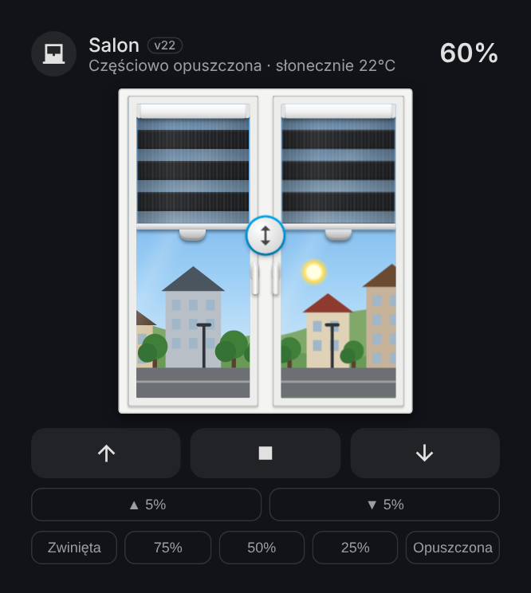
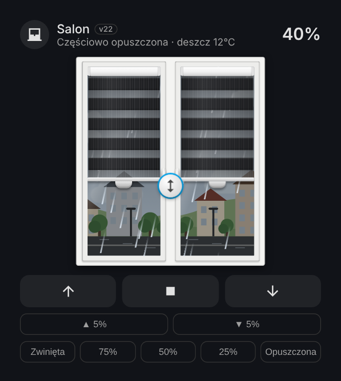
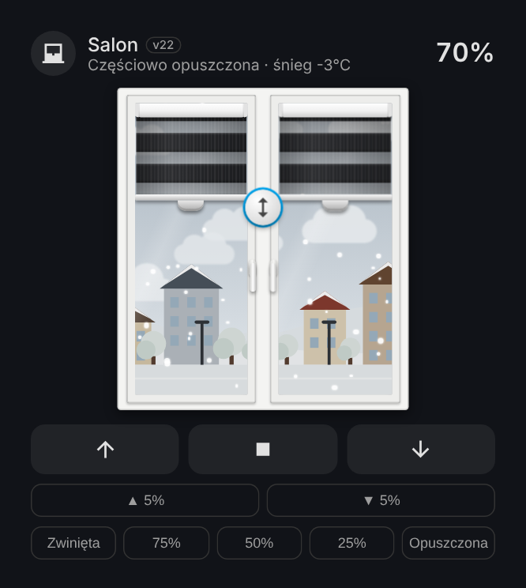
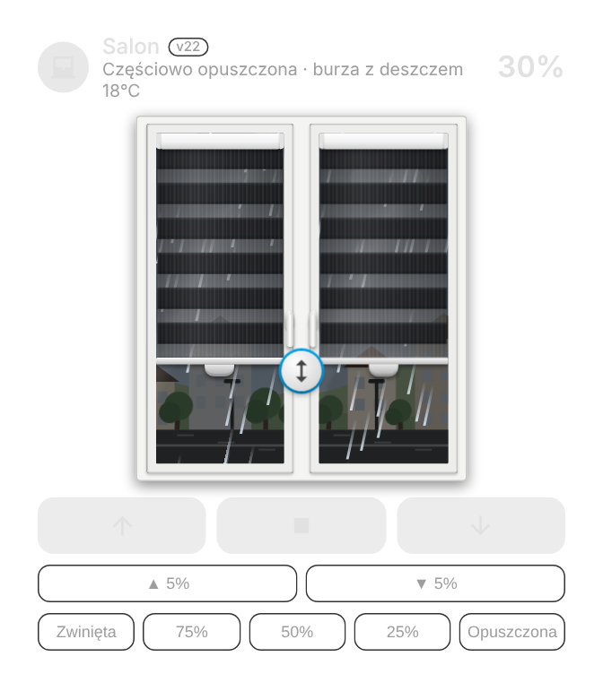
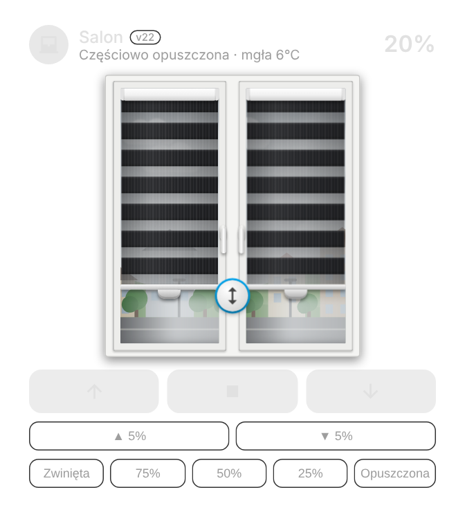
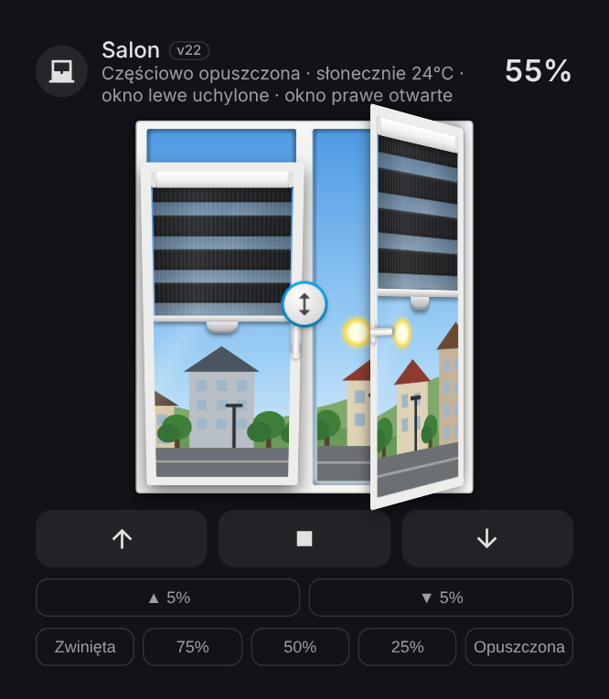

<p align="center">
  <a href="https://github.com/superdarco78/roleta-realistyczna/releases"></a>
  <a href="https://github.com/superdarco78/roleta-realistyczna/releases"></a>
  <a href="https://github.com/superdarco78/roleta-realistyczna/commits/main"></a>
  <a href="https://github.com/superdarco78/roleta-realistyczna/commits/main"></a>
  <br>
  <a href="https://hacs.xyz"></a>
  <a href="https://www.home-assistant.io/"></a>
  <a href="LICENSE"></a>
    <br>
  <a href="https://github.com/superdarco78/roleta-realistyczna/actions/workflows/release.yml"></a>
  <a href="https://github.com/superdarco78/roleta-realistyczna/stargazers"></a>
  <a href="https://github.com/superdarco78/roleta-realistyczna/issues"></a>
  
  
  <a href="https://github.com/superdarco78"></a>
</p>
<p align="center">
  <a href="https://www.home-assistant.io/"></a>
  <a href="https://community.home-assistant.io/"></a>
  <a href="https://forum.arturhome.pl/"></a>
  <a href="https://hacs.xyz/"></a>
</p>

# 🪟 Roleta dzień-noc

README: **Polski** | [English](README_EN.md)

<p align="center"></p>

> 💡 **Roleta dzień-noc** to karta do Home Assistanta, która pokazuje Twoją roletę dzień-noc (zebra) na prawdziwym oknie. Roletę przesuwasz palcem, animacja jedzie w tempie silnika, a za szybą widać aktualną pogodę i porę dnia. Przy dodaniu karty kreator ustawia wszystko sam.

<p align="center">
  
  
  
</p>

## 📑 Spis treści

- [✨ Co potrafi](#-co-potrafi)
- [🖼 Jak wygląda](#-jak-wygląda)
- [⬇️ Instalacja przez HACS (zalecana)](#️-instalacja-przez-hacs-zalecana)
- [🧩 Dodanie karty i kreator](#-dodanie-karty-i-kreator)
- [🛠 Instalacja ręczna](#-instalacja-ręczna)
- [🎛 Edytor](#-edytor)
- [🔄 Aktualizacja](#-aktualizacja)
- [❓ Problemy](#-problemy)
- [📝 Historia zmian](CHANGELOG.md)

## ✨ Co potrafi

| | |
|---|---|
| 🪄 **Kreator** | Sam się otwiera przy nowej karcie: wybierasz roletę, karta pokazuje, co wykryła, i gotowe. |
| 🔍 **Sama wykrywa** | Grupę rolet (lewa + prawa), prędkość silnika z tego samego urządzenia, kontaktrony okna z tego samego pomieszczenia. Bez pomocników i bez YAML. |
| 🌍 **Twój język** | Polski albo angielski, automatycznie według języka ustawionego w Home Assistancie. |
| 👆 **Sterowanie palcem** | Uchwyt na listwie rusza jedno skrzydło, okrągły uchwyt na środku oba. Dotknięcie w trakcie jazdy = STOP. Przyciski ▲ ■ ▼, kroki 5% i szybkie pozycje. |
| ⏱ **Animacja 1:1 z silnikiem** | Tempo z prędkości silnika albo z kalibracji jednym przyciskiem. Fałszywe meldunki Zigbee (0% / 100%) nie psują animacji. |
| 🌦 **Pogoda za oknem** | Słońce, chmury, deszcz, burza, śnieg, mgła i wiatr. Bez integracji pogody karta sama pobiera ją z internetu (Open-Meteo, bez klucza). |
| 🌅 **Pora dnia** | Dzień, złota godzina, zmierzch i noc z księżycem, gwiazdami i zapalonymi oknami, według słońca w HA. |
| 🪟 **Okno jak prawdziwe** | Uchylone albo otwarte według kontaktronu, obracające się klamki, słupek stały lub ruchomy, 1 albo 2 skrzydła. |
| 🎨 **Kolory jak w sklepie** | Tkaniny dzień-noc, okleiny drewnopodobne (złoty dąb, orzech, winchester…) i kolory gładkie. |

## 🖼 Jak wygląda

| ☀️ Słońce | 🌧 Deszcz | ❄️ Śnieg |
|:---:|:---:|:---:|
|  |  |  |
| **⛈ Burza** | **🌫 Mgła** | **🌙 Noc** |
|  |  |  |
| **🪟 Okno uchylone i otwarte** | **🎨 Okleina drewnopodobna** | **🇬🇧 Po angielsku (język HA)** |
|  |  |  |

<details>
<summary>🌅 Pory dnia (dzień, złota godzina, zmierzch, noc, uchylenie, otwarcie)</summary>

</details>

## ⬇️ Instalacja przez HACS (zalecana)

Wymaga [HACS](https://hacs.xyz). Dzięki HACS każdą nową wersję zainstalujesz jednym kliknięciem „Aktualizuj”.

**Krok 1.** Kliknij ten przycisk:

[](https://my.home-assistant.io/redirect/hacs_repository/?owner=superdarco78&repository=roleta-realistyczna&category=plugin)

**Krok 2.** Kliknij **Otwórz link**. Gdy HACS zapyta „Dodać repozytorium?”, kliknij **Dodaj**.


**Krok 3.** Kliknij **Pobierz** na dole po prawej i jeszcze raz **Pobierz** w okienku. Potem odśwież stronę: **Ctrl + Shift + R** (w telefonie zamknij i otwórz aplikację).


<details>
<summary>Przycisk nie działa? Dodaj repozytorium ręcznie</summary>

1. **HACS → ⋮ (prawy górny róg) → Własne repozytoria**.
2. Repozytorium: `https://github.com/superdarco78/roleta-realistyczna`, typ: **Dashboard**, **Dodaj**.
3. Wyszukaj „Roleta dzień-noc” → **Pobierz**.
</details>

## 🧩 Dodanie karty i kreator

**Krok 4.** Na pulpicie kliknij ołówek (Edytuj) → **＋ Dodaj kartę** → wpisz **Roleta** → kliknij kartę.


**Krok 5.** Kreator otworzy się sam. Wybierz roletę, sprawdź, co karta wykryła, i wybierz wygląd.

<p>
  
  
  
</p>

✅ **Gotowe.**

## 🛠 Instalacja ręczna

<details>
<summary>Bez HACS (rozwiń)</summary>

1. Pobierz `roleta-realistyczna.js` z [najnowszego wydania](https://github.com/superdarco78/roleta-realistyczna/releases/latest).

   
2. W dodatku **File editor** wgraj plik do folderu `www`.

   
3. **Ustawienia → Pulpity**.

   
4. **⋮ → Zasoby**.

   
5. **Dodaj zasób**: `/local/roleta-realistyczna.js`, **Moduł JavaScript**, **Utwórz**, potem **Ctrl + Shift + R**.

   
6. Dodaj kartę jak w [kroku 4](#-dodanie-karty-i-kreator).
</details>

## 🎛 Edytor

Wszystko ustawisz klikając, bez YAML. Działy: 🎨 Wygląd, 🪟 Okno, ⏱ Ruch i kalibracja, ⚙️ Zaawansowane. Na górze podgląd na żywo, który nie rusza prawdziwej rolety. Przycisk „🌍 Zapisz jako domyślne” przenosi Twój wygląd na wszystkie karty.


<details>
<summary>YAML (dla zaawansowanych)</summary>

```yaml
type: custom:roleta-realistyczna
entity: cover.zaluzje_salon   # roleta albo grupa rolet (lewa + prawa)
name: Salon
```
</details>

## 🔄 Aktualizacja

Przez HACS: gdy pojawi się nowa wersja, w **Ustawieniach** zobaczysz aktualizację „Roleta dzień-noc”. Kliknij **Aktualizuj** i odśwież stronę. Co się zmieniło: [📝 Historia zmian](CHANGELOG.md) albo [Wydania](https://github.com/superdarco78/roleta-realistyczna/releases).

## ❓ Problemy

- **Nie ma karty na liście** → odśwież stronę (Ctrl + Shift + R), w telefonie zamknij i otwórz aplikację.
- **Animacja nie zgadza się z roletą** → w edytorze: ⏱ Ruch i kalibracja → **Kalibruj automatycznie**.
- **Coś innego** → [zgłoś błąd](https://github.com/superdarco78/roleta-realistyczna/issues/new/choose).

Testowane z silnikami **Moes TS0601** (zigbee2mqtt); działa z każdą encją `cover.*`.

## 📜 Licencja

[CC BY-NC-SA 4.0](LICENSE) © [superdarco78](https://github.com/superdarco78). Do własnego, niekomercyjnego użytku z podaniem autora.
