<p align="center">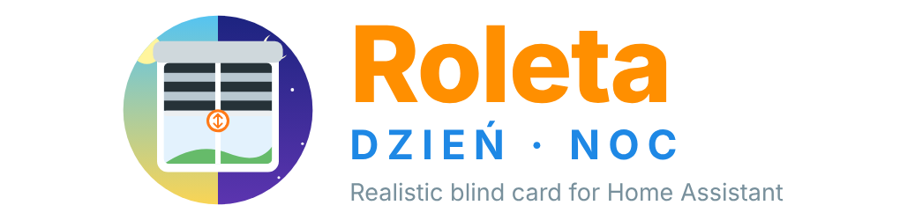</p>

<p align="center">
  <a href="https://github.com/superdarco78/roleta-realistyczna/releases"></a>
  <a href="https://github.com/superdarco78/roleta-realistyczna/releases"></a>
  <a href="https://github.com/superdarco78/roleta-realistyczna/stargazers"></a>
  <a href="https://github.com/superdarco78/roleta-realistyczna/commits/main"></a>
  <br>
  <a href="https://hacs.xyz"></a>
  <a href="https://www.home-assistant.io/"></a>
  <a href="#translations"></a>
  <a href="LICENSE"></a>
  <br>
  <a href="https://github.com/superdarco78/roleta-realistyczna/actions/workflows/validate.yml"></a>
  <a href="https://github.com/superdarco78/roleta-realistyczna/actions/workflows/release.yml"></a>
  <a href="https://github.com/superdarco78/roleta-realistyczna/issues"></a>
  <a href="https://github.com/superdarco78"></a>
  <br>
  <a href="https://community.home-assistant.io/"></a>
  <a href="https://forum.arturhome.pl/"></a>
  <!-- Support (uncomment when the link is ready): <a href="https://www.buymeacoffee.com/LINK"></a> -->
</p>

<p align="center"><a href="https://my.home-assistant.io/redirect/hacs_repository/?owner=superdarco78&repository=roleta-realistyczna&category=plugin"></a></p>
README: [🇵🇱 Polski](README.md) | **🇬🇧 English**

> [!TIP]
> The card works with **any roller blind** in Home Assistant (`cover.*`): Zigbee, Z-Wave, Tuya, Shelly, Somfy and more. It looks best with a day-night (zebra) blind on a 2-sash window, but 1 sash works too. When you add the card, **the wizard sets everything up for you**.

<p align="center"><picture><source media="(prefers-color-scheme: dark)" srcset="img/animacja-ciemna.gif">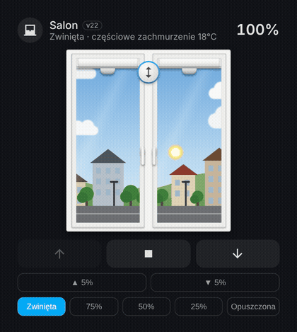</picture></p>

<a name="start-in-4-steps"></a>
## 🚀 Start in 4 steps

<p align="center"><a href="#installation">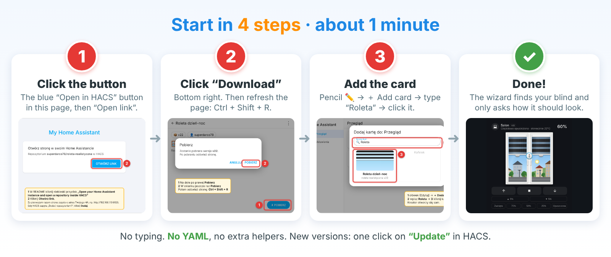</a></p>

<p align="center"><a href="https://my.home-assistant.io/redirect/hacs_repository/?owner=superdarco78&repository=roleta-realistyczna&category=plugin"></a><br><sub>⬆️ This is the button from step 1</sub></p>


#### 📖 Glossary: what do these words mean?


| Word | In plain words |
|---|---|
| **Home Assistant (HA)** | The app that runs your smart home. |
| **HACS** | An “app store” for HA add-ons. You install the card and its updates from here. |
| **Card** | A tile on your HA screen, like this blind. |
| **Dashboard** | An HA screen that holds cards. |
| **`cover.…` entity** | Your blind, as HA sees it. |
| **Contact sensor** | A window sensor: knows if it is closed, tilted or open. |
| **Open / 100%** | Blind fully up, window uncovered. |
| **Closed / 0%** | Blind fully down, window covered. |
| **YAML** | Typing settings by hand. **Not needed here.** |


---

<a name="table-of-contents"></a>
## 📑 Table of contents

- [🚀 Start in 4 steps](#start-in-4-steps)
- [⬆️ Upgrading to v23](#upgrading-to-v23)
- [🪟 The Roleta dzień-noc card](#the-roleta-dzien-noc-card)
  - [Goals](#goals)
  - [How it looks](#how-it-looks)
  - [Colours and wood finishes](#colours-and-wood-finishes)
- [⬇️ Installation](#installation)
  - [With HACS (recommended)](#with-hacs-recommended)
  - [Manual](#manual)
- [🪄 First run: the wizard](#first-run-the-wizard)
- [👆 Actions: how to control it](#actions-how-to-control-it)
- [🎛 Editor](#editor)
- [📄 Options](#options)
- [🧪 Examples](#examples)
- [🔎 Auto-detection](#auto-detection)
- [🔌 Moes / Tuya motors](#moes-tuya-motors)
- [🧩 Card elements](#card-elements)
- [❓ FAQ](#faq)
- [🙋 Help wanted](#help-wanted)
- [🌍 Translations](#translations)
- [🧱 Project structure](#project-structure)
- [☕ Support](#support)

---

<a name="upgrading-to-v23"></a>
## ⬆️ Upgrading to v23

> [!IMPORTANT]
> Version 23 **does not change** your settings. Existing cards keep working.

**What's new**

- 🪄 A **7-step wizard** for beginners. Every step says **what** you pick and **why**.
- 🔍 The card finds blinds, motors, window sensors and weather by itself, best matches first.
- 🧹 Lists show only matching devices: no gates, garages or motion sensors.
- 🧭 When something is missing, the wizard says what to do and opens the right HA page in one click.
- 📋 Add a copy of the card to another dashboard or a new “Blinds” view in one click.
- 🌍 The wizard, card and menu follow your HA profile language.

**What to do:** click **Update** in HACS, then refresh with **Ctrl + Shift + R**. Full list: [📝 Changelog](CHANGELOG.md).

---


<a name="the-roleta-dzien-noc-card"></a>
## 🪟 The Roleta dzień-noc card

The card shows your day-night blind on a real-looking window. Drag the blind with your finger; the animation moves at the speed of the motor, and you see the current weather and time of day behind the glass.

<p align="center"><picture><source media="(prefers-color-scheme: dark)" srcset="img/opis-elementow-ciemny.png">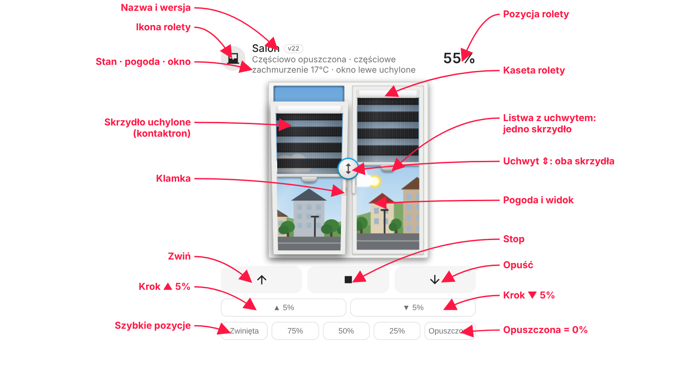</picture></p>

<a name="goals"></a>
### Goals

- ✅ The blind on screen should look and move **like the real one**.
- ✅ Setup should take **a minute, no YAML**, no extra helpers.
- ✅ Comfortable **touch control** on phones and tablets.
- ✅ Work with **any** blind and **any** home (language, weather, sensors).

<a name="how-it-looks"></a>
### How it looks

**Weather:**

<table>
<tr>
<td align="center" width="33%"><b>☀️ Sun</b><br><picture><source media="(prefers-color-scheme: dark)" srcset="img/stany/dzien.png">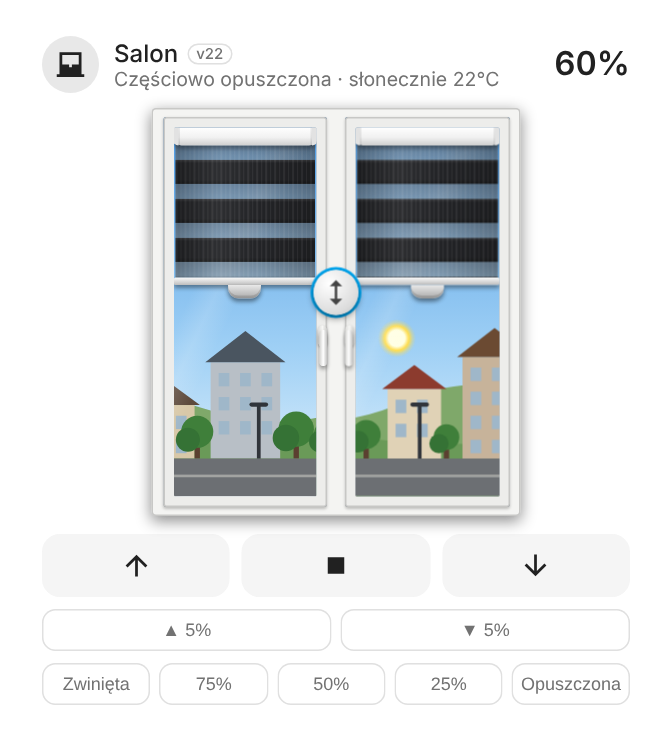</picture></td>
<td align="center" width="33%"><b>🌧 Rain</b><br><picture><source media="(prefers-color-scheme: dark)" srcset="img/stany/deszcz.png">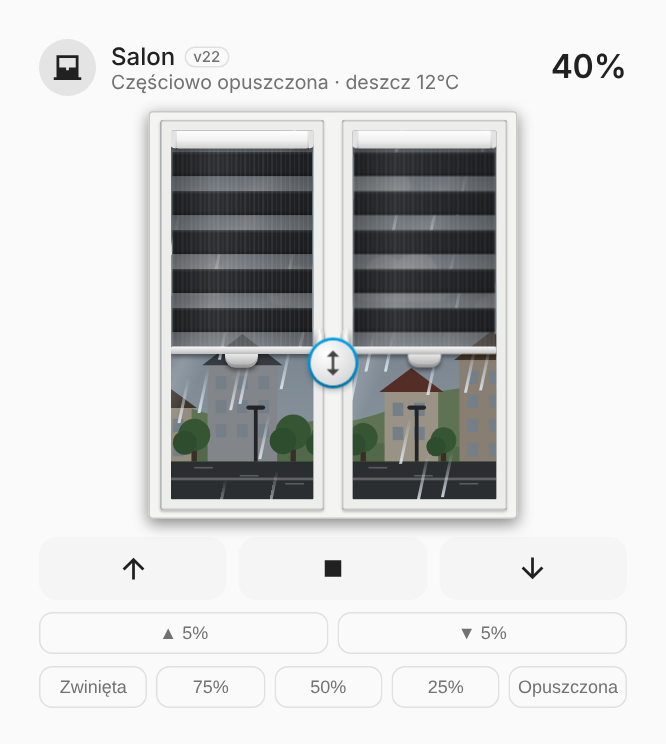</picture></td>
<td align="center" width="33%"><b>⛈ Storm</b><br><picture><source media="(prefers-color-scheme: dark)" srcset="img/stany/burza.png">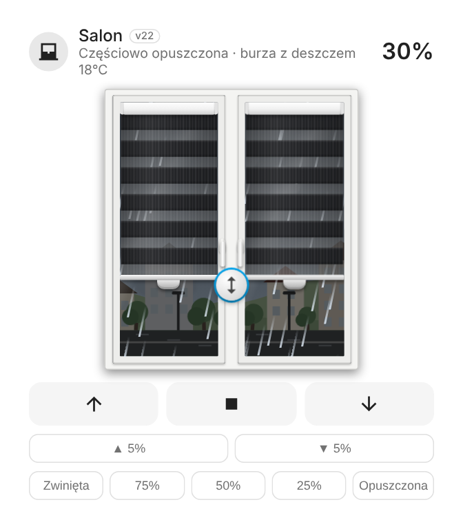</picture></td>
</tr>
<tr>
<td align="center" width="33%"><b>❄️ Snow</b><br><picture><source media="(prefers-color-scheme: dark)" srcset="img/stany/snieg.png">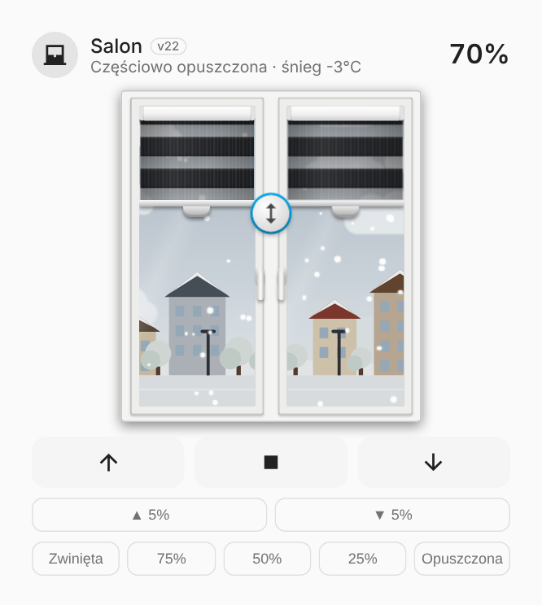</picture></td>
<td align="center" width="33%"><b>🌫 Fog</b><br><picture><source media="(prefers-color-scheme: dark)" srcset="img/stany/mgla.png">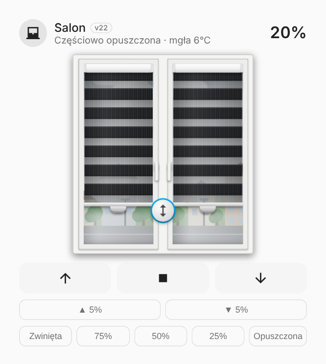</picture></td>
<td align="center" width="33%"><b>☁️ Cloudy (English UI)</b><br><picture><source media="(prefers-color-scheme: dark)" srcset="img/stany/en.png">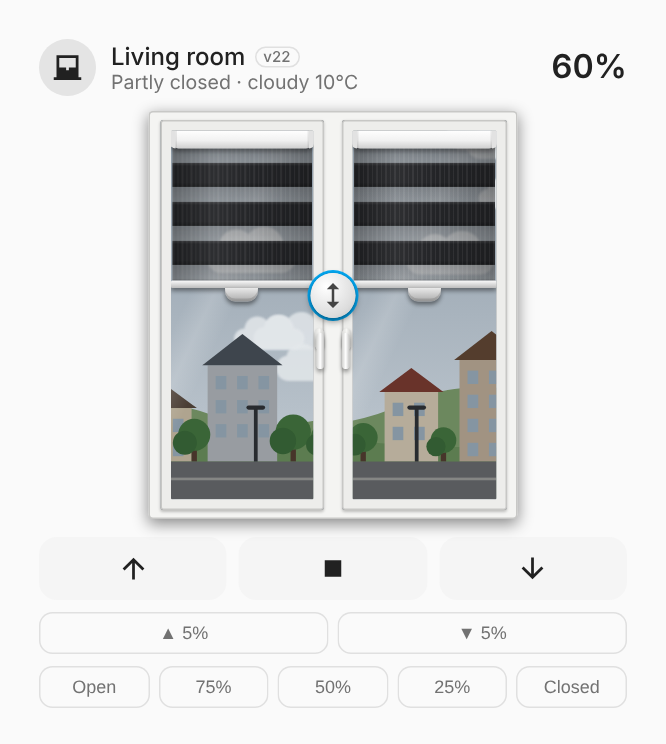</picture></td>
</tr>
</table>

**Time of day:**

<table>
<tr>
<td align="center" width="33%"><b>☀️ Day</b><br><picture><source media="(prefers-color-scheme: dark)" srcset="img/stany/zwinieta.png">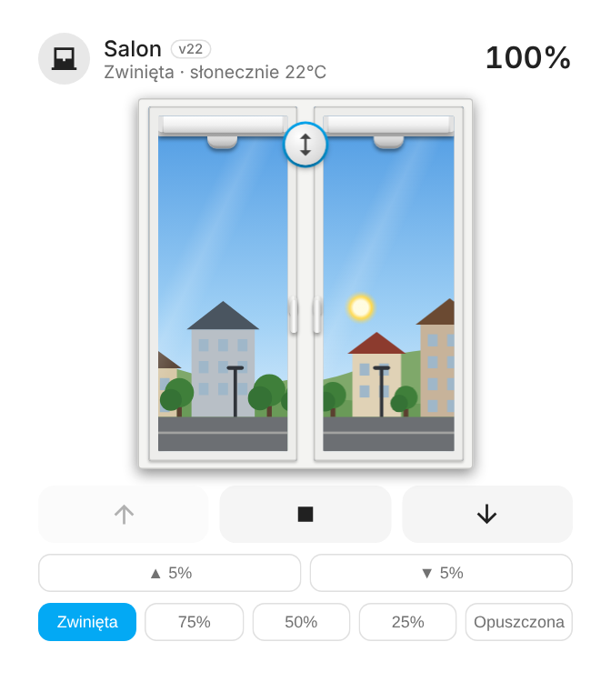</picture></td>
<td align="center" width="33%"><b>🌅 Sunset</b><br><picture><source media="(prefers-color-scheme: dark)" srcset="img/stany/zachod.png">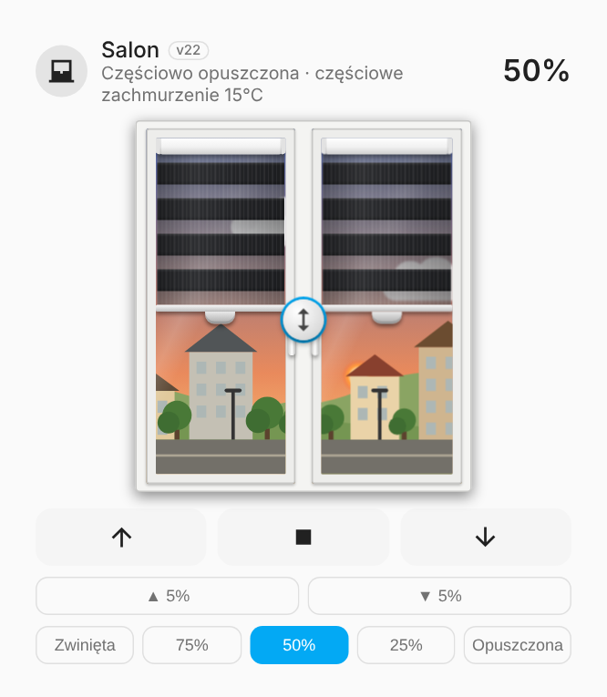</picture></td>
<td align="center" width="33%"><b>🌙 Night</b><br><picture><source media="(prefers-color-scheme: dark)" srcset="img/stany/noc.png">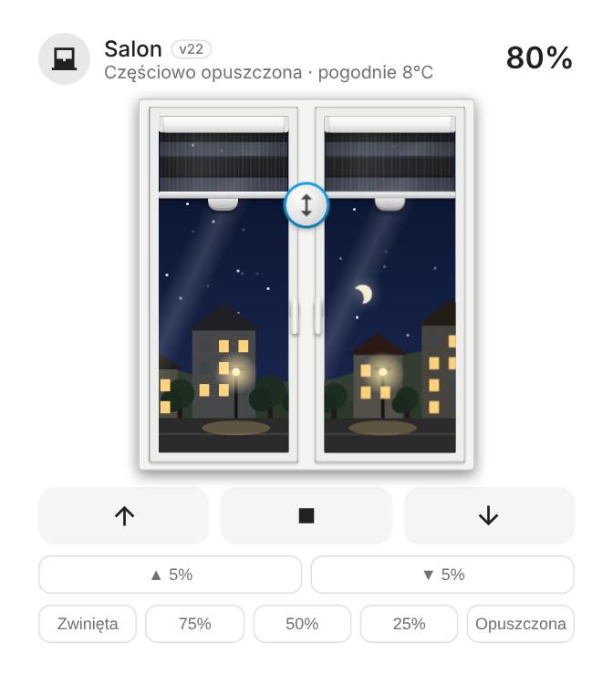</picture></td>
</tr>
</table>

**Blind position:**

<table>
<tr>
<td align="center" width="33%"><b>⬆️ Open (100%)</b><br><picture><source media="(prefers-color-scheme: dark)" srcset="img/stany/zwinieta.png"></picture></td>
<td align="center" width="33%"><b>↕️ Half (50%)</b><br><picture><source media="(prefers-color-scheme: dark)" srcset="img/stany/zachod.png"></picture></td>
<td align="center" width="33%"><b>⬇️ Closed (0%)</b><br><picture><source media="(prefers-color-scheme: dark)" srcset="img/stany/opuszczona.png">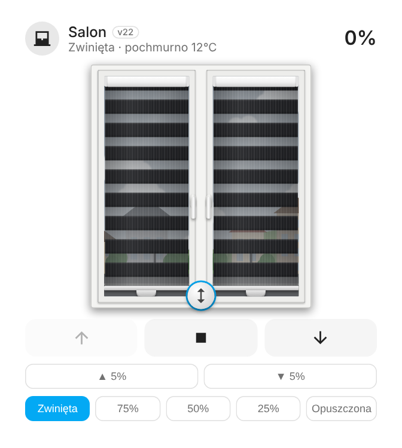</picture></td>
</tr>
</table>

**Window (from contact sensors):**

<table>
<tr>
<td align="center" width="33%"><b>↘ Left tilted</b><br><picture><source media="(prefers-color-scheme: dark)" srcset="img/stany/uchylone.png">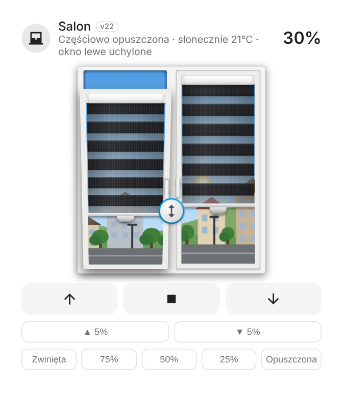</picture></td>
<td align="center" width="33%"><b>↔ Right opened</b><br><picture><source media="(prefers-color-scheme: dark)" srcset="img/stany/otwarte.png">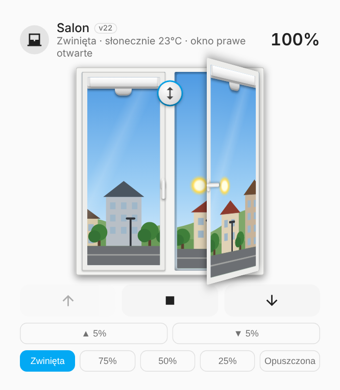</picture></td>
<td align="center" width="33%"><b>🪟 Tilted and opened</b><br><picture><source media="(prefers-color-scheme: dark)" srcset="img/stany/okno.png">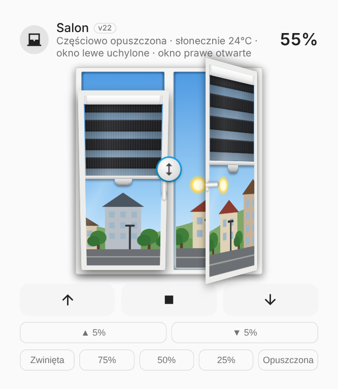</picture></td>
</tr>
</table>

<a name="colours-and-wood-finishes"></a>
### Colours and wood finishes

<table>
<tr>
<td align="center" width="33%"><b>Golden oak + beige</b><br><picture><source media="(prefers-color-scheme: dark)" srcset="img/stany/zloty.png">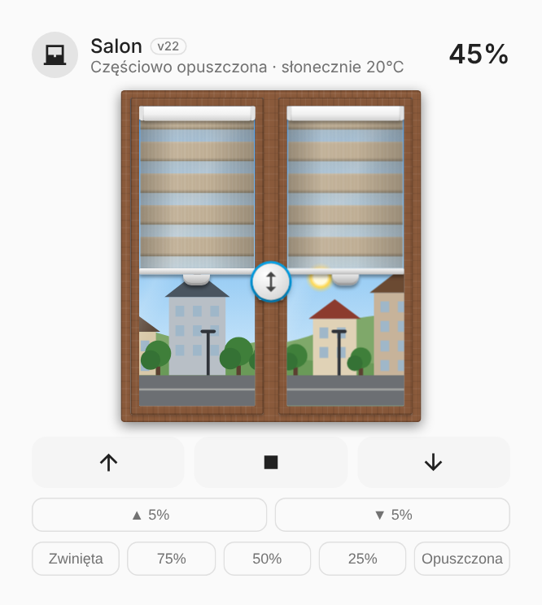</picture></td>
<td align="center" width="33%"><b>Anthracite + turquoise</b><br><picture><source media="(prefers-color-scheme: dark)" srcset="img/stany/turkus.png">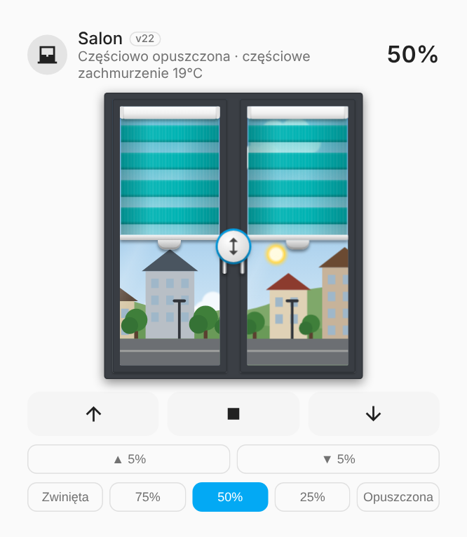</picture></td>
<td align="center" width="33%"><b>1 sash</b><br><picture><source media="(prefers-color-scheme: dark)" srcset="img/stany/jedno.png">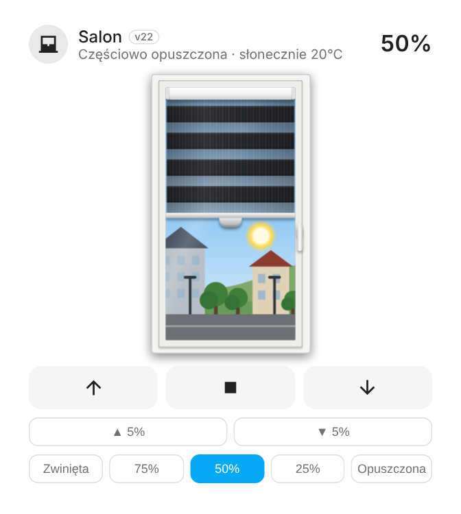</picture></td>
</tr>
</table>

---

<a name="installation"></a>
## ⬇️ Installation

**Requirements:** Home Assistant **2024.8** or newer and a blind as a `cover.*` entity.

<a name="with-hacs-recommended"></a>
### With HACS (recommended)

**Step 1.** Click:

[](https://my.home-assistant.io/redirect/hacs_repository/?owner=superdarco78&repository=roleta-realistyczna&category=plugin)

**Step 2.** Click **Open link**, then **Add** when HACS asks to add the repository.

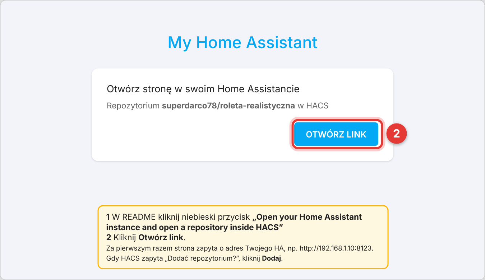

**Step 3.** Click **Download** (bottom right), then **Download** again.

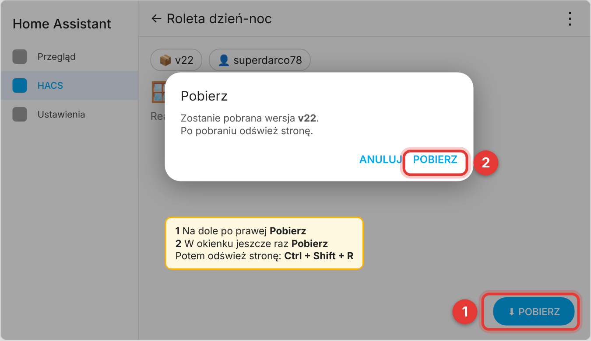

**Step 4.** Refresh the page: **Ctrl + Shift + R** (on a phone, close and reopen the HA app).


#### Button not working? Add the repository in HACS manually


1. **HACS → ⋮ → Custom repositories**.
2. Repository `https://github.com/superdarco78/roleta-realistyczna`, type **Dashboard**, **Add**.
3. Search for “Roleta dzień-noc” → **Download**.


<a name="manual"></a>
### Manual

Screenshots show the Polish HA interface; the buttons are in the same places in English.

**Step 1. Download the card file**

Open the [latest release](https://github.com/superdarco78/roleta-realistyczna/releases/latest) and click `roleta-realistyczna.js`.

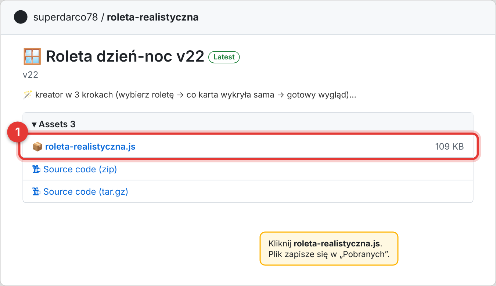

**Step 2. Upload it to Home Assistant**

Open **File editor**, click the folder icon, go to `www` and upload the file with the up arrow.

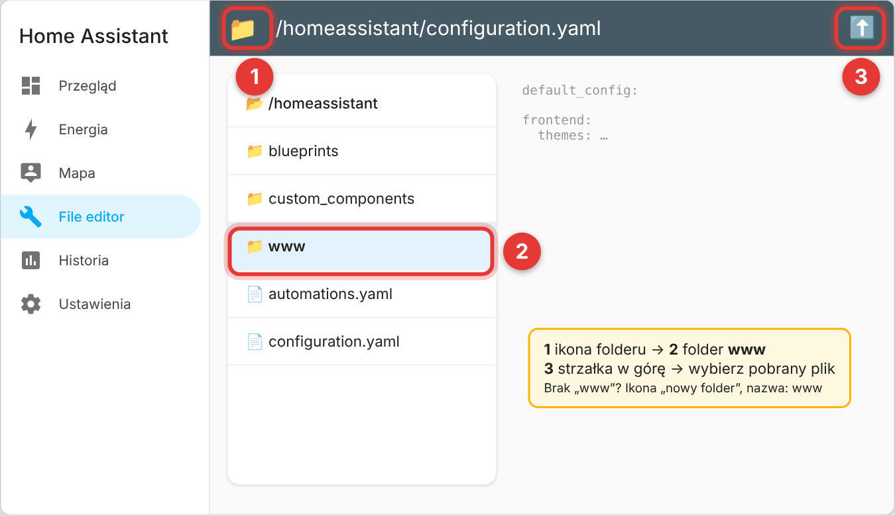

**Step 3. Open Dashboards**

Click **Settings** at the bottom of the left menu, then **Dashboards**.

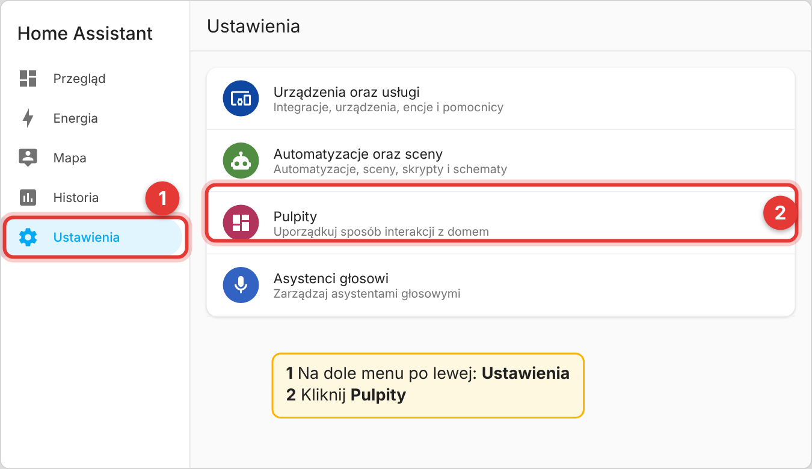

**Step 4. Open Resources**

Click the three dots **⋮** top right, then **Resources**.

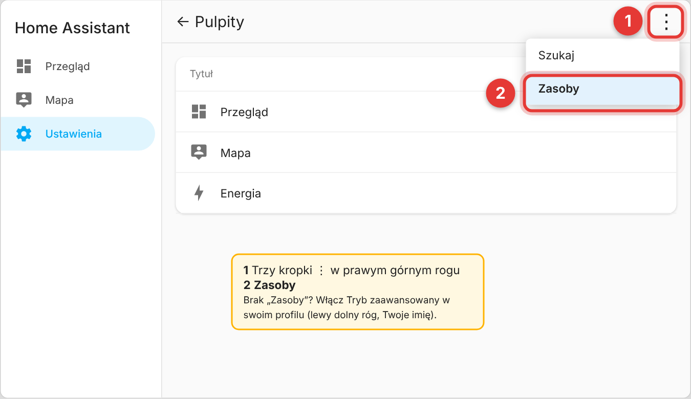

**Step 4a. No “Resources”? Turn on Advanced mode**

Click your name at the bottom of the left menu and turn on **Advanced mode**. Then go back to step 4.

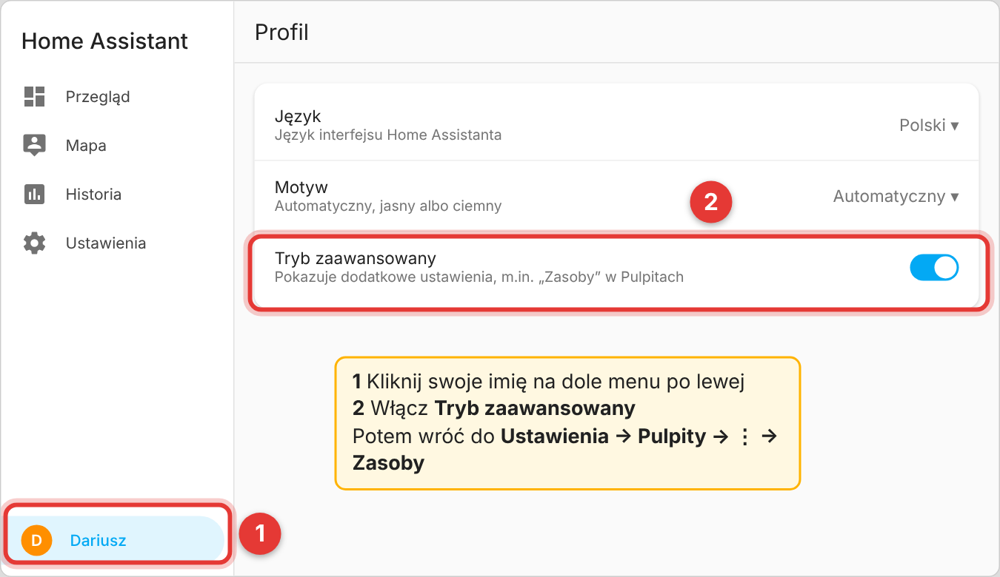

**Step 5. Add the card as a resource**

Click **Add resource**, type `/local/roleta-realistyczna.js`, choose **JavaScript module** and click **Create**. Then refresh: **Ctrl + Shift + R**.

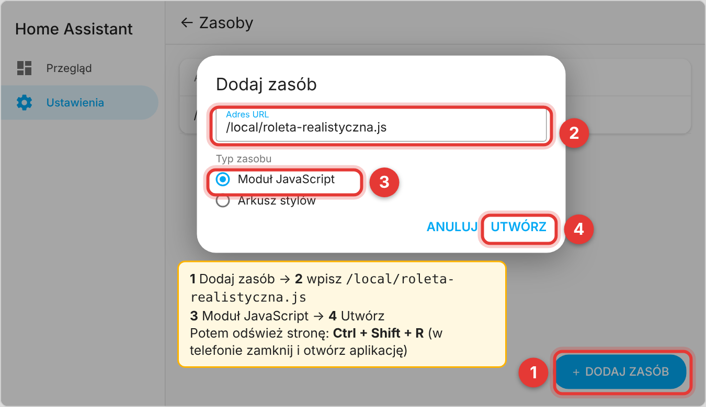

---

<a name="first-run-the-wizard"></a>
## 🪄 First run: the wizard

**Step 1. Add the card**

On your dashboard click the pencil, then **＋ Add card**, type **Roleta** and click the card.

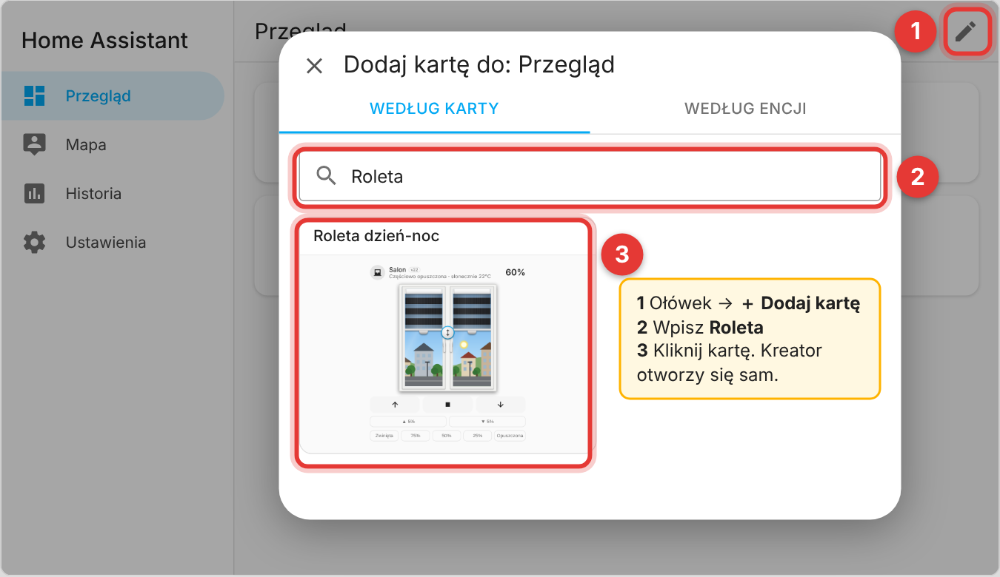

**Step 2. The wizard guides you**

The wizard opens by itself. It has 7 short steps:

| Step | What you pick | Why |
|:---:|---|---|
| 1 | 🪟 **Blind** | Which blind (or blind group) the card controls |
| 2 | 🔲 **Window** | How many sashes and which blind is on which |
| 3 | ⏱ **Motor** | So the animation moves as fast as the real blind |
| 4 | 🚪 **Window sensors** | So the card shows a tilted or open window |
| 5 | 🌦 **Weather** | Real weather behind the glass |
| 6 | 🎨 **Look and name** | A ready colour set and the card title |
| 7 | ✅ **Summary** | Check everything and choose where the card goes |

> [!TIP]
> Not sure? Keep what is selected at the top of the list. The card picked the best match.

<br>

**Step 1 of 7: pick the blind**

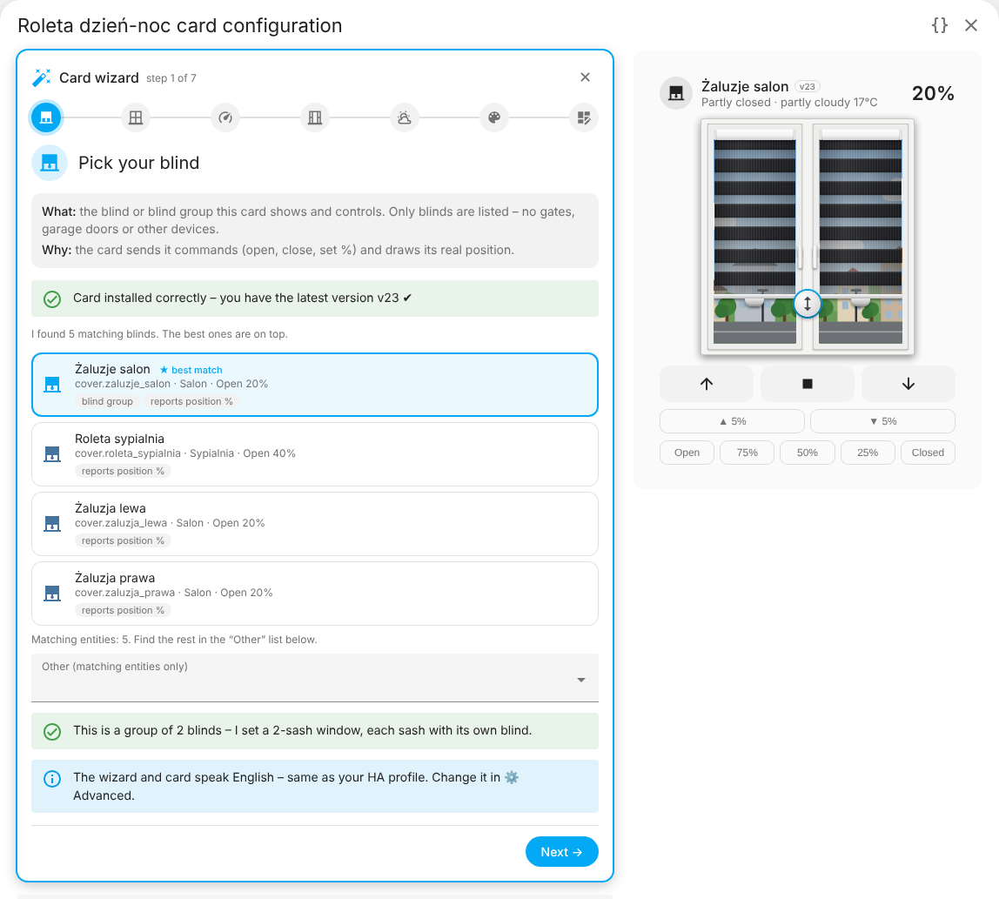

<br>

**Step 7 of 7: check and save**

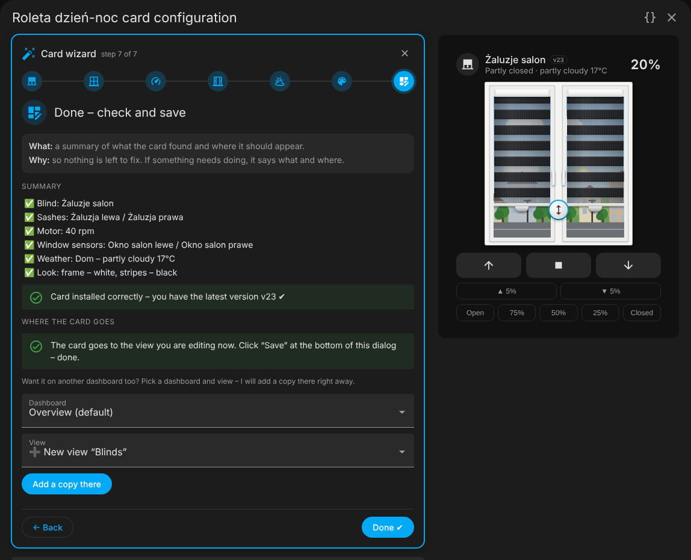

✅ **Done.** Click **Save**. Change anything later in the [editor](#editor).

---


<a name="actions-how-to-control-it"></a>
## 👆 Actions: how to control it

| Action | How | Result |
|---|---|---|
| **Move one sash** | Drag the handle 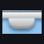 on its bottom rail | Only that sash moves. |
| **Move both sashes** | Drag the round centre handle  | Both move together. |
| **Move anywhere** | Drag on the glass | Both sashes (or one with `osobno`). |
| **Stop** | Tap the blind while it moves, or  | STOP. Next tap = move the other way. |
| **Open / close fully** |  /  | Moves to the end. |
| **Small step** | ▲ 5% / ▼ 5% | Clicks add up. |
| **Quick position** | Open / 75% / 50% / 25% / Closed | Set your own with `pozycje`. |

A dashed **“→ 50%”** line shows where the blind is going.

<picture><source media="(prefers-color-scheme: dark)" srcset="img/opis-elementow-ciemny.png"></picture>

---

<a name="editor"></a>
## 🎛 Editor

Settings are grouped in collapsible sections, each with **↺ Restore defaults**. The live preview at the top **never moves the real blind**; pin it 📌 to see every change.

| Section | What you set |
|---|---|
| 🎨 Look | Stripe colours, frame colour (wood finishes and plain), sashes, mullion, height. |
| 🪟 Window | Contact sensors per sash, tilted or opened, how much. |
| ⏱ Motion & calibration | Travel time from motor speed, learned, or **🤖 Auto-calibrate**. |
| ⚙️ Advanced | Language, buttons, handles, steps, quick positions, vibration, inverted position, weather source, own background photo. |
| 🌍 Global | **Save as default** for all blind cards. |

<picture><source media="(prefers-color-scheme: dark)" srcset="img/edytor-jasne/para-podglad-dzialy-ciemne.png">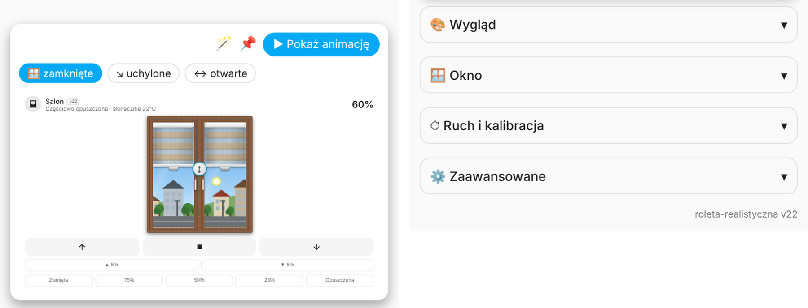</picture>

<picture><source media="(prefers-color-scheme: dark)" srcset="img/edytor-jasne/kontaktrony-ciemne.png">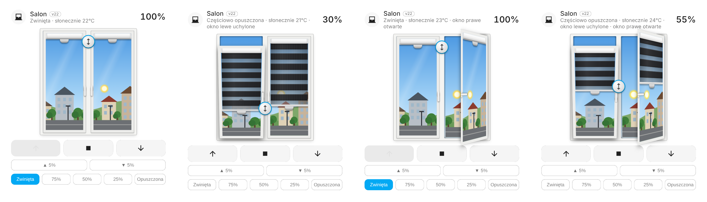</picture>

---

<a name="options"></a>
## 📄 Options

Everything can be set in the editor; the tables are for YAML fans. Option names are Polish.

| Name | Type | Default | Description |
|---|---|---|---|
| `type` | text | **required** | `custom:roleta-realistyczna` |
| `entity` | entity | **required** | `cover.*` or a blind group (left + right). |
| `name` | text | entity name | Card title. |
| `jezyk` | text | `auto` | `auto` (HA language), `pl`, `en`. |
| `kolor` | text | `czarny` | Solid stripe colour (palette name or `#rrggbb`). |
| `siatka` | text | like solid | Sheer stripe colour. |
| `rama` | text | `#f4f4f2` | Frame colour, e.g. `#8a5a3b` golden oak, `#3b3f45` anthracite. |
| `skrzydla` | number | `2` | Sashes: `1` or `2`. |
| `slupek` | text | `staly` | Mullion: `staly` (fixed) or `ruchomy` (moving). |
| `klamki` | bool | `true` | Handles turn when tilted/opened. |
| `wysokosc` | number | `260` | Window height in px. |
| `czujnik_lewe` / `czujnik_prawe` | entity | auto | Contact sensor per sash. |
| `tryb_lewe` / `tryb_prawe` | text | `uchyl` | `uchyl` (tilt) or `otworz` (open). |
| `kat_uchyl` | number | `14` | Tilt angle. |
| `otwarcie` | number | `40` | Opening width (%). |
| `auto_czujniki` | bool | `true` | Find contact sensors in the blind's area. |
| `roleta_lewa` / `roleta_prawa` | entity | – | Separate blinds per sash. |
| `czas` | number / `auto` | `auto` | Full travel time (s). |
| `predkosc_lewa` / `predkosc_prawa` | entity | auto | Motor speed `number.*`. |
| `odwroc` | bool | `false` | Inverted position. |
| `zrodlo` | text | `auto` | Weather: `auto`, `internet`, `brak` (none). |
| `pogoda` | entity | `auto` | `weather.*` entity. |
| `niebo` / `widok` | bool | `true` | Sky & weather / drawn street view. |
| `tlo` | text | – | Own background photo, e.g. `/local/view.jpg`. |
| `przyciski` | bool | `true` | Buttons and quick positions. |
| `pozycje` | text | `100,75,50,25,0` | Quick positions (100 = open). |
| `krok` | number | `5` | ▲/▼ step in %, `0` = off. |
| `uchwyty` / `uchwyt_srodek` | bool | `true` | Rail handles / centre handle. |
| `osobno` | bool | `false` | Dragging the glass moves one sash only. |
| `wibracja` | bool | `true` | Haptic feedback. |


---

<a name="examples"></a>
## 🧪 Examples

```yaml
type: custom:roleta-realistyczna
entity: cover.living_room
```

```yaml
type: custom:roleta-realistyczna
entity: cover.living_left
name: Living room
roleta_lewa: cover.living_left
roleta_prawa: cover.living_right
czujnik_lewe: binary_sensor.window_left
tryb_lewe: uchyl
czujnik_prawe: binary_sensor.window_right
tryb_prawe: otworz
```

```yaml
type: custom:roleta-realistyczna
entity: cover.bedroom
skrzydla: 1
kolor: bezowy
rama: '#8a5a3b'
zrodlo: brak
jezyk: en
```


---

<a name="auto-detection"></a>
## 🔎 Auto-detection

| What | How |
|---|---|
| **Blind group** | Suggested first for a new card. |
| **Motor speed** | `number.*_motor_speed` on the same device. |
| **Contact sensors** | Window/door `binary_sensor.*` in the same area; left/right by name. |
| **Weather** | `weather.*`; if none, Open-Meteo for your home location (no API key). |
| **Language** | From your HA profile. |


---

<a name="moes-tuya-motors"></a>
## 🔌 Moes / Tuya motors

Tested with **Moes TS0601** (zigbee2mqtt). Travel time from motor speed ≈ 20.2 + 394 / rpm. False 0% / 100% reports while moving are ignored.


---

<a name="card-elements"></a>
## 🧩 Card elements

| Element | Meaning |
|:---:|---|
|  | Blind icon: opens the entity details. |
|  | Centre handle: both sashes. |
|  | Rail handle: one sash. |
|  | Handles: down = closed, sideways = open, up = tilted. |
|  | Open fully. |
|  | Stop. |
|  | Close fully. |
|  | Sun: daytime from `sun.sun`. |
| 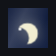 | Moon and stars: night. |


---

<a name="faq"></a>
## ❓ FAQ


#### The card is not in “Add card”

Refresh with <b>Ctrl + Shift + R</b>, or restart the HA app on your phone.


#### Animation faster/slower than the blind

Editor → ⏱ Motion → <b>🤖 Auto-calibrate</b>.


#### Blind moves the wrong way

Enable <b>Invert position</b> in ⚙️ Advanced.


#### No weather

⚙️ Advanced → weather source <code>auto</code> or <code>internet</code>.


Still stuck? [Open an issue](https://github.com/superdarco78/roleta-realistyczna/issues/new/choose) or ask on the [HA forum](https://community.home-assistant.io/).


---

<a name="help-wanted"></a>
## 🙋 Help wanted

Different blind or motor? Tell us how it works with the card, with a screenshot. Ideas: [request a feature](https://github.com/superdarco78/roleta-realistyczna/issues/new/choose).


---

<a name="translations"></a>
## 🌍 Translations

| Language | Status |
|---|---|
| 🇵🇱 Polski | ✅ 100% |
| 🇬🇧 English | ✅ 100% |

Want your language? Copy [`translations/en.json`](translations/en.json) to `translations/<code>.json`, translate it and send it in an [issue](https://github.com/superdarco78/roleta-realistyczna/issues/new/choose) or a pull request.


---

<a name="project-structure"></a>
## 🧱 Project structure

Source code is split into modules in [`src/`](src) (card, editor, 7-step wizard, dashboards, weather, detection and ranking, motor timing, colours, global settings, language), texts in [`translations/`](translations), tests in [`test/`](test). `npm install` → `npm run check` lints, tests and bundles everything with esbuild into `dist/roleta-realistyczna.js`, the single file HACS installs. GitHub runs the same checks on every change.


---

<a name="support"></a>
## ☕ Support

If you like the card, leave a ⭐ at the top of the page. Thank you!

<!-- Support (uncomment when links are ready):
[](https://www.buymeacoffee.com/LINK)
-->

---

[CC BY-NC-SA 4.0](LICENSE) © [superdarco78](https://github.com/superdarco78). Personal, non-commercial use with attribution.

> [!NOTE]
> **© 2026 superdarco78.** The card, graphics and texts are licensed under [CC BY-NC-SA 4.0](LICENSE). Free for use in your home. Selling, reselling, republishing as your own or any commercial use only with the author's permission. Official source: [github.com/superdarco78/roleta-realistyczna](https://github.com/superdarco78/roleta-realistyczna).
