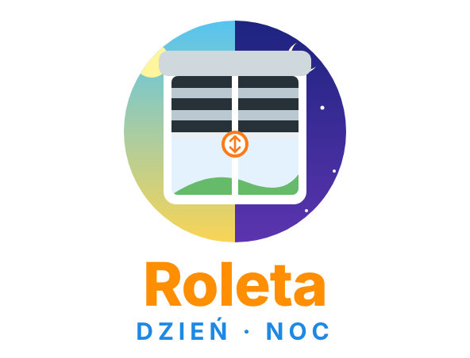
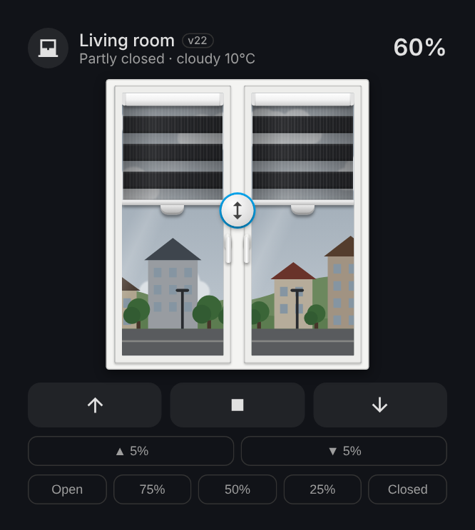
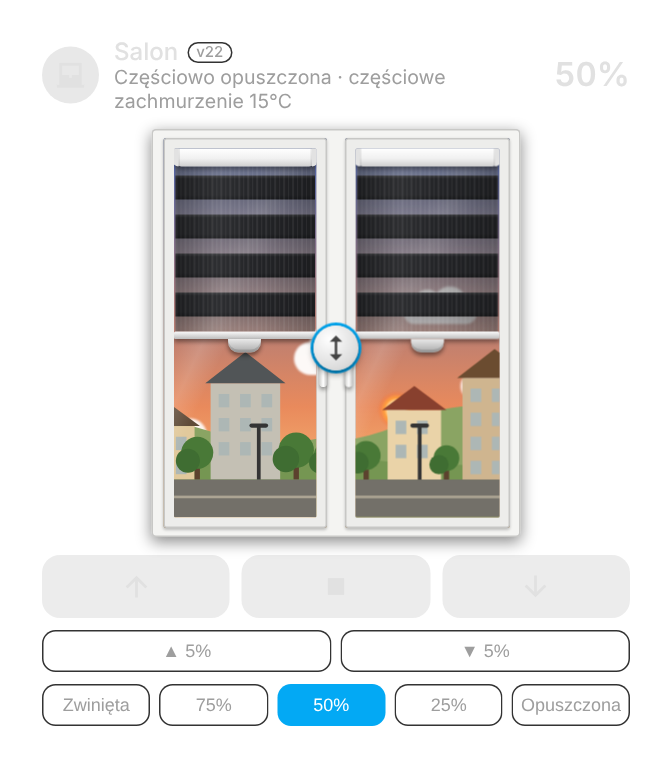
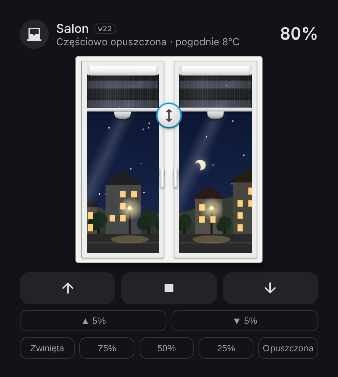

<p align="center">
  <a href="https://github.com/superdarco78/roleta-realistyczna/releases"></a>
  <a href="https://github.com/superdarco78/roleta-realistyczna/releases"></a>
  <a href="https://github.com/superdarco78/roleta-realistyczna/commits/main"></a>
  <a href="https://github.com/superdarco78/roleta-realistyczna/commits/main"></a>
  <br>
  <a href="https://hacs.xyz"></a>
  <a href="https://www.home-assistant.io/"></a>
  <a href="LICENSE"></a>
  
</p>
<p align="center">
  <a href="https://www.home-assistant.io/"></a>
  <a href="https://community.home-assistant.io/"></a>
  <a href="https://forum.arturhome.pl/"></a>
  <a href="https://hacs.xyz/"></a>
</p>

# 🪟 Day-night roller blind

README: [Polski](README.md) | **English**

<p align="center"></p>

> 💡 A Home Assistant card that shows your day-night (zebra) roller blind on a realistic window. Drag the blind with your finger, the animation follows the motor speed, and the live weather and time of day are visible outside. A setup wizard configures everything when you add the card.

<p align="center">
  
  
  
</p>

## ✨ Features

- 🪄 **Setup wizard** opens automatically: pick the blind, review what was detected, choose a look.
- 🔍 **Auto-detection** of blind groups (left + right), motor speed entity and window contact sensors in the same area. No helpers, no YAML.
- 🌍 **Your language**: Polish or English, following the Home Assistant language.
- 👆 **Touch control**: per-sash handle, centre handle for both, tap while moving = STOP, ▲ ■ ▼ buttons, 5% steps, quick positions.
- ⏱ **1:1 motor animation** from motor speed or one-click calibration; ignores false 0%/100% Zigbee reports.
- 🌦 **Live weather** outside the window (sun, clouds, rain, storm, snow, fog, wind); without a weather integration it uses Open-Meteo (no API key).
- 🌅 **Time of day**: day, golden hour, dusk and night with moon, stars and lit windows.
- 🪟 **Realistic window**: tilted or opened by contact sensor, turning handles, fixed or moving mullion, 1 or 2 sashes.
- 🎨 **Real-world colours**: day-night fabrics, wood-grain foils (golden oak, walnut, winchester…) and solid colours.

## ⬇️ Installation (HACS, recommended)

[](https://my.home-assistant.io/redirect/hacs_repository/?owner=superdarco78&repository=roleta-realistyczna&category=plugin)

1. Click the button above → **Open link** → **Add** (if HACS asks).
2. Click **Download** (bottom right) → **Download**, then reload the page (Ctrl + Shift + R).
3. Dashboard → ✏️ Edit → **+ Add card** → search **Roleta** → the wizard opens.

Manual install: download `roleta-realistyczna.js` from the [latest release](https://github.com/superdarco78/roleta-realistyczna/releases/latest), upload it to `/config/www/`, add resource `/local/roleta-realistyczna.js` (JavaScript module).

```yaml
type: custom:roleta-realistyczna
entity: cover.living_room   # a blind or a group of blinds (left + right)
```

## 📜 License

[CC BY-NC-SA 4.0](LICENSE) © [superdarco78](https://github.com/superdarco78). Personal, non-commercial use with attribution.
